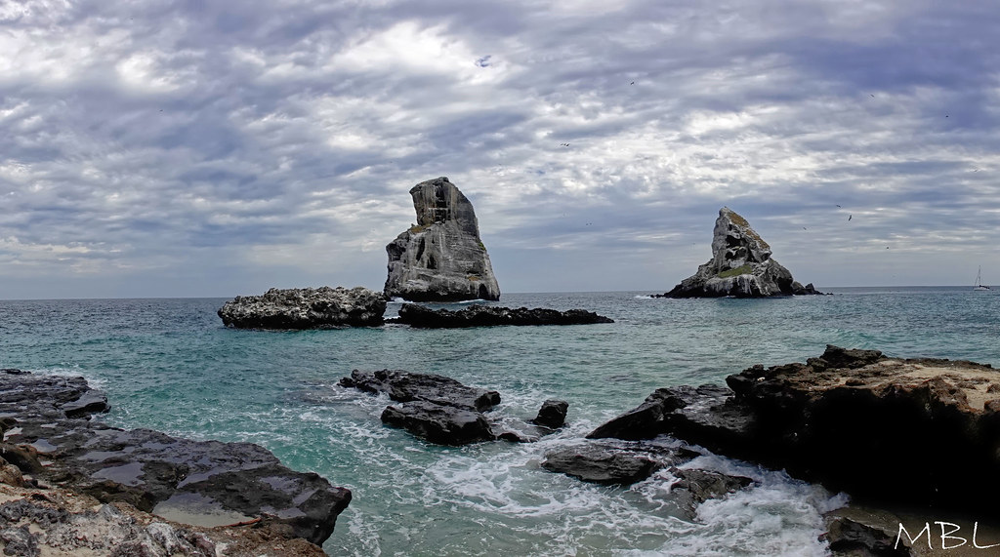
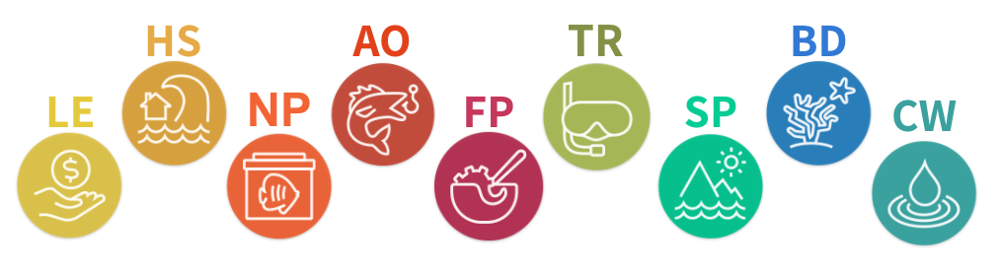

<div class="button-container">
  <a href="project_update_october_2026.html" class="custom-button">
    🌐 View in English
  </a>
</div>

---


Esta página presenta las puntuaciones de estatus actual más recientes del Índice de Salud Oceánica del Golfo de California, e incluye los cambios recomendados por los Grupos de Trabajo de Expertos y de Goalkeepers. Para comparar cómo le va a cada región a lo largo del tiempo, pase el cursor sobre cada gráfica; una puntuación de 100 significa que la condición de una meta es igual a su punto de referencia.  

Para cada meta ofrecemos su descripción, las puntuaciones de componentes, las fuentes de datos, los métodos y los recursos de la meta (por ejemplo, los resúmenes ejecutivos compartidos con el Grupo de Trabajo de Expertos y con los grupos de Goalkeepers, y las versiones anteriores del modelo de la meta).

Para ver la versión anterior de esta página del sitio, consulte [Actualización del proyecto (otoño 2026)](project_update_fall_2026_spanish.html). 

---

{fig-alt="Las monjas, Isla Isabel, Nayarit" width="100%"}

*Las monjas, Isla Isabel, Nayarit. Crédito fotográfico: Miguel Betancourt-Lozano. [Flickr](https://www.flickr.com/photos/mbetancourtlozano/51950696476/).*

---

```{r}
#| echo: false
#| warning: false
#| message: false

library(tidyverse)
library(plotly)
library(here)

rgn_labels <- c(
  "Region_1" = "Alto Golfo occidental",
  "Region_2" = "Islas del Medio (oeste)",
  "Region_3" = "Golfo central occidental",
  "Region_4" = "Golfo sur occidental",
  "Region_5" = "Alto Golfo oriental",
  "Region_6" = "Islas del Medio (este)",
  "Region_7" = "Costa sur de Sonora",
  "Region_8" = "Costa de Sinaloa",
  "Region_9" = "Entrada del Golfo"
)

rgn_colors <- c(
  "Region_1" = "#C03729",
  "Region_2" = "#E68C7C",
  "Region_3" = "#FC8F24",
  "Region_4" = "#dcaa38",
  "Region_5" = "#cbd2a0",
  "Region_6" = "#98a25a",
  "Region_7" = "#747428",
  "Region_8" = "#627391",
  "Region_9" = "#8d61a9"
)

region_levels <- paste0("Region_", 1:9)

# plotly colors by the legend name ("western upper gulf"), so remap colors from Region_1 keys to those names
rgn_label_colors <- setNames(
  unname(rgn_colors[region_levels]),
  unname(rgn_labels[region_levels])
)

# turn whatever region column we got into Region_1 ... Region_9, then add a legend name
add_rgn_labels <- function(df) {
  df %>%
    mutate(
      rgn_id = as.character(rgn_id),
      # some files write "Region 1" instead of "Region_1"
      rgn_id = stringr::str_replace_all(rgn_id, " ", "_"),
      # some files just use 1, 2, 3 instead of Region_1, Region_2, Region_3
      rgn_id = ifelse(
        stringr::str_detect(rgn_id, "^[0-9]+$"),
        paste0("Region_", rgn_id),
        rgn_id
      ),
      # factor so plots always show regions in 1-9 order
      rgn_id = factor(rgn_id, levels = region_levels),
      # as.character() looks up by name ("Region_1"), not by the factor's number (1)
      rgn_label = factor(
        rgn_labels[as.character(rgn_id)],
        levels = unname(rgn_labels[region_levels])
      )
    )
}

# make ferrer's overall csvs (and similar files) match the columns goal_plotly expects
prep_cs <- function(df) {

  # ferrer files: OHI_region_no; our plots: rgn_id
  if ("OHI_region_no" %in% names(df) && !"rgn_id" %in% names(df)) {
    df <- df %>% dplyr::rename(rgn_id = OHI_region_no)
  }

  # ferrer files: FP_score, AO_score, etc.; our plots: current_status
  acronym_score <- names(df)[stringr::str_detect(names(df), "_[Ss]core$")]
  acronym_score <- setdiff(acronym_score, "current_status")

  if (!"current_status" %in% names(df) && length(acronym_score) >= 1) {
    df <- df %>% dplyr::rename(current_status = dplyr::all_of(acronym_score[[1]]))
  }

  # some files just call the score column "score"
  if (!"current_status" %in% names(df) && "score" %in% names(df)) {
    df <- df %>% mutate(current_status = score)
  }

  df %>%
    mutate(
      rgn_id = as.character(rgn_id),
      # ferrer files: region_1; our plots: Region_1
      rgn_id = stringr::str_replace(rgn_id, "^region_", "Region_"),
      year = as.numeric(year),
      current_status = as.numeric(current_status)
    ) %>%
    add_rgn_labels()
}

# static component figures live in images/component_figs/ (same pattern as LSP)
# copy into chapters/figs so github pages can serve them
include_component_fig <- function(filename) {
  candidates <- c(
    here::here("images/component_figs", filename),
    here::here("../images/component_figs", filename),
    here::here("chapters/figs", filename),
    file.path("figs", filename)
  )
  src <- candidates[file.exists(candidates)][1]

  dest_dir <- if (dir.exists("figs")) {
    "figs"
  } else {
    here::here("chapters/figs")
  }
  dir.create(dest_dir, recursive = TRUE, showWarnings = FALSE)
  dest <- file.path(dest_dir, filename)

  if (!is.na(src) && !identical(normalizePath(src, mustWork = FALSE), normalizePath(dest, mustWork = FALSE))) {
    file.copy(src, dest, overwrite = TRUE)
  }

  if (file.exists(dest)) {
    knitr::include_graphics(dest)
  } else {
    knitr::asis_output(paste0(
      "*No se encontró la figura `", filename, "` en `images/component_figs/`.*"
    ))
  }
}

# first existing csv path (mazu first, then local copies)
read_first_csv <- function(paths) {
  hit <- paths[file.exists(paths)][1]
  if (is.na(hit)) {
    stop("No se encontró ninguno de estos CSV:\n", paste(" -", paths, collapse = "\n"))
  }
  read_csv(hit, show_col_types = FALSE)
}

goal_plotly <- function(
    df,
    title,
    y = "current_status",
    y_title = "Puntuación (sobre 100)",
    y_range = c(0, 105),
    add_goal_line = TRUE,
    goal_line_name = "Meta (100/100)"
) {
  # score plots: round to the nearest whole number so hover does not show 5 decimals
  if (identical(y, "current_status")) {
    df <- df %>% mutate(current_status = round(as.numeric(current_status)))
  }

  df <- df %>%
    arrange(rgn_label, year)

  year_breaks <- sort(unique(df$year[!is.na(df$year)]))

  # drop missing y values so plotly does not plot a gap marker; connectgaps still draws the line
  df_drawn <- df %>% filter(!is.na(.data[[y]]))

  yaxis_list <- list(title = y_title)
  if (!is.null(y_range)) {
    yaxis_list$range <- y_range
  }
  if (identical(y, "current_status")) {
    yaxis_list$hoverformat <- ".0f"
    yaxis_list$tickformat <- ".0f"
  }

  p <- plot_ly(
    df_drawn,
    x = ~year,
    y = as.formula(paste0("~`", y, "`")),
    color = ~rgn_label,
    colors = rgn_label_colors,
    type = "scatter",
    mode = "lines+markers",
    # if a year is missing (e.g. pathogens 2020), still connect the years on either side
    connectgaps = TRUE
  ) %>%
    layout(
      title = title,
      xaxis = list(
        title = "Año",
        # force integer year ticks (2019, 2020, ...) instead of 2019.5
        tickmode = "array",
        tickvals = year_breaks,
        ticktext = as.character(as.integer(year_breaks)),
        range = range(year_breaks)
      ),
      yaxis = yaxis_list,
      legend = list(title = list(text = "Región"))
    )

  if (isTRUE(add_goal_line)) {
    p <- p %>%
      add_lines(
        x = range(year_breaks),
        y = c(100, 100),
        line = list(color = "black", width = 2, dash = "dash"),
        name = goal_line_name,
        # inherit = false so this reference line is not treated as another region
        inherit = FALSE
      )
  }

  p
}
```

## Puntuaciones de las metas en todo el Golfo

La gráfica de abajo muestra el **patrón general de cada meta en todas las regiones OHI.**  Para cada año, es el promedio de las puntuaciones de estatus actual regionales. Cada meta tiene un color que coincide con su ícono (distinto de la paleta que representa a cada región OHI). 

{fig-alt="Todas las metas del Índice de Salud Oceánica del Golfo de California. De izquierda a derecha: Medios de Vida y Economías, Servicios de Hábitat, Productos Naturales, Oportunidades de Acceso, Turismo y Recreación, Sentido de Pertenencia, Biodiversidad y Aguas Limpias." width="100%"}

```{r}
#| echo: false
#| warning: false
#| message: false

# Spanish display names for the legend / hover (colors and order still key off the English goal names)
goal_names_es <- c(
  "Tourism & Recreation" = "Turismo y Recreación",
  "Food Provisioning" = "Provisión de Alimentos",
  "Livelihoods & Economies" = "Medios de Vida y Economías",
  "Sense of Place" = "Sentido de Pertenencia",
  "Access Opportunities" = "Oportunidades de Acceso",
  "Habitat Services" = "Servicios de Hábitat",
  "Biodiversity" = "Biodiversidad",
  "Clean Waters" = "Aguas Limpias",
  "Natural Products" = "Productos Naturales"
)

gulf_goal_paths <- tribble(
  ~goal, ~version, ~file,
  "Tourism & Recreation", "v1.1", "TR_Scores_1.1_df_Oct2026.csv",
  "Food Provisioning", "v1.0", "FP_Scores_1.0_df_Sep112026.csv",
  "Livelihoods & Economies", "v1.1", "LE_Scores_1.1_df_Oct2026.csv",
  "Sense of Place", "v1.1", "SP_Scores_1.1_df_Oct2026.csv",
  "Access Opportunities", "v1.0", "AO_Scores_1.0_df_Sep112026.csv",
  "Habitat Services", "v1.0", "HS_Scores_1.0_df_Sep112026.csv",
  "Biodiversity", "v1.0", "BD_Scores_1.0_df_Sep112026.csv",
  "Clean Waters", "v1.1", "CW_Scores_1.1_df_Oct2026.csv",
  "Natural Products", "v1.1", "NP_Scores_1.1_df_Oct192026.csv"
) %>%
  mutate(
    goal_label = paste0(unname(goal_names_es[goal]), " (", version, ")")
  )

gulf_wide <- purrr::pmap_dfr(
  gulf_goal_paths,
  function(goal, version, file, goal_label) {
    read_first_csv(c(
      here::here("/home/shares/ohi/OHI_GOC/goal_prep/final_cs_scores", version, file),
      here::here("final_cs_scores", version, file),
      here::here("../final_cs_scores", version, file)
    )) %>%
      prep_cs() %>%
      filter(year %in% 2019:2025) %>%
      group_by(year) %>%
      summarise(
        current_status = round(mean(current_status, na.rm = TRUE)),
        n_regions = sum(!is.na(current_status)),
        .groups = "drop"
      ) %>%
      mutate(goal = goal, version = version, goal_label = goal_label)
  }
)

gulf_wide_drawn <- gulf_wide %>%
  mutate(current_status = as.integer(round(current_status))) %>%
  filter(!is.na(current_status))

# Fixed goal colors and legend order (LE → CW), matching the goal icons.
goal_order_names <- c(
  "Livelihoods & Economies",
  "Habitat Services",
  "Natural Products",
  "Access Opportunities",
  "Food Provisioning",
  "Tourism & Recreation",
  "Sense of Place",
  "Biodiversity",
  "Clean Waters"
)
goal_hex <- c(
  "Livelihoods & Economies" = "#d7c137",
  "Habitat Services" = "#d2a22e",
  "Natural Products" = "#de692e",
  "Access Opportunities" = "#b85136",
  "Food Provisioning" = "#a73953",
  "Tourism & Recreation" = "#a8b64c",
  "Sense of Place" = "#4cbd8a",
  "Biodiversity" = "#3a7dbd",
  "Clean Waters" = "#51a0a0"
)

legend_lookup <- gulf_wide_drawn %>%
  distinct(goal, goal_label) %>%
  mutate(goal = factor(goal, levels = goal_order_names)) %>%
  arrange(goal)

legend_order <- c(
  as.character(legend_lookup$goal_label),
  setdiff(as.character(unique(gulf_wide_drawn$goal_label)), as.character(legend_lookup$goal_label))
)

year_breaks_gulf <- sort(unique(gulf_wide_drawn$year))

gulf_p <- plotly::plot_ly()
for (g in legend_order) {
  d <- gulf_wide_drawn %>%
    filter(goal_label == g) %>%
    arrange(year)
  goal_name <- unique(as.character(d$goal))[[1]]
  col <- unname(goal_hex[[goal_name]])
  if (is.null(col) || is.na(col)) col <- "#666666"
  gulf_p <- gulf_p %>%
    plotly::add_trace(
      data = d,
      x = ~year,
      y = ~current_status,
      type = "scatter",
      mode = "lines+markers",
      name = g,
      line = list(color = col),
      marker = list(color = col),
      connectgaps = TRUE,
      hovertemplate = paste0(g, "<br>Año: %{x}<br>Puntuación: %{y}<extra></extra>")
    )
}

gulf_p %>%
  plotly::layout(
    title = "Puntuaciones de las metas en todo el Golfo a lo largo del tiempo",
    xaxis = list(
      title = "Año",
      tickmode = "array",
      tickvals = year_breaks_gulf,
      ticktext = as.character(as.integer(year_breaks_gulf)),
      range = range(year_breaks_gulf)
    ),
    yaxis = list(
      title = "Puntuación (sobre 100)",
      range = c(0, 105),
      hoverformat = ".0f",
      tickformat = ".0f"
    ),
    legend = list(
      title = list(text = "Meta"),
      traceorder = "normal"
    ),
    shapes = list(list(
      type = "line",
      x0 = min(year_breaks_gulf),
      x1 = max(year_breaks_gulf),
      y0 = 100,
      y1 = 100,
      line = list(color = "black", width = 2, dash = "dash")
    ))
  )
```


---

En todas las secciones siguientes del sitio mostramos las puntuaciones de cada meta por región a lo largo del tiempo, para representar el **cambio en el tiempo por región**.  Esas gráficas muestran mejor los patrones regionales importantes que el promedio de todo el Golfo de arriba.

---

# {width=8% height=8%} Turismo y Recreación {#tr}

La meta de Turismo y Recreación mide la cantidad, la calidad y la sostenibilidad de las experiencias que tienen las personas cuando visitan áreas costeras y marinas. Esta meta destaca el valor personal y cultural del turismo costero y de las actividades recreativas, en contraste con los ingresos que generan.

Evaluamos tres dimensiones del uso turístico y recreativo: cantidad, calidad y sostenibilidad. Todos los indicadores se miden para los municipios costeros a menos de 50 km del litoral del Golfo, integrando los mejores datos de acceso abierto disponibles sobre visitas internacionales y nacionales, oportunidades de recreación y prácticas de sostenibilidad.

```{r}
#| echo: false
#| warning: false
#| message: false
tr_overall <- read_csv(
  here::here("/home/shares/ohi/OHI_GOC/goal_prep/final_cs_scores/v1.1/TR_Scores_1.1_df_Oct2026.csv"),
  show_col_types = FALSE
) %>%
  prep_cs()
goal_plotly(tr_overall, "Turismo y Recreación: Estatus actual")
```

*Figura 1. Gráfica interactiva del estatus actual de esta meta a lo largo del tiempo, por región OHI. Las puntuaciones que se muestran son de la versión 1.1 (octubre de 2026).*

::: {.callout-tip collapse="true"}
# 📊 Puntuaciones de componentes

**Este es el componente de Cantidad, que evalúa si el turismo internacional y nacional está alcanzando las metas de Plan México para 2030.**

```{r}
#| echo: false
#| warning: false
#| message: false
tr_quantity <- read_csv(
  "/home/shares/ohi/OHI_GOC/goal_prep/final_cs_scores/v1.1/subgoals/TR_Quantity_Scores_1.1_df_Oct2026.csv",
  show_col_types = FALSE
) %>%
  prep_cs() %>%
  mutate(current_status = pmin(as.numeric(current_status), 100)) %>%
  filter(year >= 2019, year <= 2025)
goal_plotly(tr_quantity, "Turismo y Recreación: Cantidad")
```

*Figura 2. Gráfica interactiva del estatus actual de esta meta a lo largo del tiempo, por región OHI. Las puntuaciones que se muestran son de la versión 1.1 (octubre de 2026).*

---

**Este es el componente de Calidad, que evalúa si las visitas son seguras y cuentan con buen apoyo de servicios de alimentos, cultura y recreación, en relación con las mejores condiciones observadas en el Golfo.**

```{r}
#| echo: false
#| warning: false
#| message: false
tr_quality <- read_csv(
  "/home/shares/ohi/OHI_GOC/goal_prep/final_cs_scores/v1.1/subgoals/TR_Quality_Scores_1.1_df_Oct2026.csv",
  show_col_types = FALSE
) %>%
  prep_cs() %>%
  filter(year %in% 2019:2025)
goal_plotly(tr_quality, "Turismo y Recreación: Calidad")
```

*Figura 3. Gráfica interactiva del estatus actual de esta meta a lo largo del tiempo, por región OHI. Las puntuaciones que se muestran son de la versión 1.1 (octubre de 2026).*

---

**Este es el componente de Sostenibilidad, que evalúa si el turismo cuenta con el respaldo de hoteles y playas certificados, empleos de calidad e inversión pública en o por encima de los niveles históricos recientes.** La versión 1.1 incluye la lista actualizada de certificaciones hoteleras (Distintivo S, Green Key, Green Globe, Earthcheck, Preferred by Nature y Calidad Ambiental Turística / PNAA) y los componentes C2/C3 de SIMEC, junto con los presupuestos de CONANP y las devoluciones de derechos en la inversión en el manejo turístico.

```{r}
#| echo: false
#| warning: false
#| message: false
tr_sust <- read_csv(
  "/home/shares/ohi/OHI_GOC/goal_prep/final_cs_scores/v1.1/subgoals/TR_Sustainability_Scores_1.1_df_Oct2026.csv",
  show_col_types = FALSE
) %>%
  prep_cs() %>%
  filter(year >= 2019, year <= 2025)
goal_plotly(tr_sust, "Turismo y Recreación: Sostenibilidad")
```

*Figura 4. Gráfica interactiva del estatus actual de esta meta a lo largo del tiempo, por región OHI. Las puntuaciones que se muestran son de la versión 1.1 (octubre de 2026).*
:::

::: {.callout-caution collapse="true"}
# 🚢 Cruceros y densidad de personal de ANP (exploratorio; no incluido en la puntuación de TR)

La actividad de cruceros **debería estar en Turismo y Recreación**, pero **no se puntúa** en la puntuación general de TR de octubre de 2026 y se mantiene como **NA**. La dirección del punto de referencia no es obvia: México no ha dicho si el turismo de cruceros debería aumentar o disminuir, y aunque las líneas de crucero apoyan las economías turísticas locales, muchas personas locales quieren que disminuya. Además, una escala portuaria de 7 a 10 horas es un lapso distinto al de una visita turística típica con pernocta, y las personas pasajeras no se separan entre visitantes nacionales e internacionales, así que no encaja bien en el componente de Cantidad.

Dicho eso, como las personas expertas señalaron que era importante explorarlo, investigamos usar el promedio de referencia de 2016-2019 como la presión máxima de cruceros. Por lo tanto, si en un año y región dados hubiera más pasajeros que esa media, la puntuación de estatus actual bajaría. Encontramos opiniones encontradas sobre los cruceros, y quedó claro que un grupo de trabajo futuro debería definir cómo se ve la sostenibilidad de los cruceros del Golfo antes de incorporar esto al Índice.

Aun así, conviene destacarlo como un posible problema o área de necesidad, sobre todo en el Golfo sur occidental, que tuvo una tasa alta de aumento de pasajeros por puerto después de la pandemia de COVID. Además, el turismo de cruceros intensificado también se ha vinculado con efectos biológicos en el hábitat del tiburón ballena ([Mongabay, mayo de 2025](https://news.mongabay.com/2025/05/cruise-ships-and-intensified-tourism-in-mexico-threaten-whale-shark-habitat/)).

Las gráficas de abajo muestran los datos para discusión. **No** están incluidas en la puntuación general de estatus actual de TR.

Pasajeros de crucero por año, por región OHI (estadísticas portuarias de SECTUR, solo puertos del GoC):

```{r}
#| echo: false
#| warning: false
#| message: false
tr_cruise_detail <- read_csv(
  "/home/shares/ohi/OHI_GOC/goal_prep/tr/v2025/output_sustainability/cruise_pressure_scores_detail_2016_2025.csv",
  show_col_types = FALSE
) %>%
  mutate(
    year = as.numeric(year),
    passengers = as.numeric(passengers)
  ) %>%
  add_rgn_labels()
goal_plotly(
  tr_cruise_detail,
  "Turismo y Recreación: Pasajeros de crucero",
  y = "passengers",
  y_title = "Pasajeros de crucero por año",
  y_range = NULL,
  add_goal_line = FALSE
)
```

*Figura 5. Gráfica interactiva de pasajeros de crucero por año, por región OHI. Estos datos se muestran para discusión y no forman parte de la puntuación de Turismo y Recreación de octubre de 2026.*

---

Pasajeros de crucero por residente costero (la misma población de municipios costeros que en Calidad de TR):

```{r}
#| echo: false
#| warning: false
#| message: false
tr_cruise_detail <- read_csv(
  "/home/shares/ohi/OHI_GOC/goal_prep/tr/v2025/output_sustainability/cruise_pressure_scores_detail_2016_2025.csv",
  show_col_types = FALSE
) %>%
  mutate(
    year = as.numeric(year),
    passengers = as.numeric(passengers),
    rgn_id = as.character(rgn_id)
  )

tr_cruise_pop_path <- "/home/shares/ohi/OHI_GOC/spatial/population_municipal/interpolated_population_per_rgn_coastalmunicipios_2000_2025.csv"
if (file.exists(tr_cruise_pop_path)) {
  tr_cruise_pop <- read_csv(tr_cruise_pop_path, show_col_types = FALSE) %>%
    mutate(
      rgn_id = as.character(rgn_id),
      rgn_id = ifelse(stringr::str_detect(rgn_id, "^[0-9]+$"), paste0("Region_", rgn_id), rgn_id),
      year = as.numeric(year_interpolated),
      coastal_pop = as.numeric(population_interpolated)
    ) %>%
    dplyr::select(rgn_id, year, coastal_pop)

  tr_cruise_percap <- tr_cruise_detail %>%
    left_join(tr_cruise_pop, by = c("rgn_id", "year")) %>%
    mutate(passengers_per_resident = passengers / coastal_pop) %>%
    add_rgn_labels()

  goal_plotly(
    tr_cruise_percap,
    "Turismo y Recreación: Pasajeros de crucero por residente costero",
    y = "passengers_per_resident",
    y_title = "Pasajeros por residente costero",
    y_range = NULL,
    add_goal_line = FALSE
  )
} else {
  knitr::asis_output("*No se pudo graficar pasajeros por residente costero porque no se encontró el archivo interpolado de población costera.*")
}
```

*Figura 6. Gráfica interactiva de pasajeros de crucero por residente costero, por región OHI. Estos datos se muestran para discusión y no forman parte de la puntuación de Turismo y Recreación de octubre de 2026.*

---

Puntuación exploratoria: pasajeros por residente costero al año, comparados con la media de 2016-2019 (donde más pasajeros que esa línea base = puntuación más baja). Una puntuación de 100 significa que la densidad de pasajeros está en o por debajo de la media de 2016-2019.

```{r}
#| echo: false
#| warning: false
#| message: false
tr_cruise_score <- read_csv(
  "/home/shares/ohi/OHI_GOC/goal_prep/tr/v2025/output_sustainability/tr_sust_cruise_pressure_current_status_all_regions_2019_2025.csv",
  show_col_types = FALSE
) %>%
  mutate(
    year = as.numeric(year),
    current_status = as.numeric(score)
  ) %>%
  add_rgn_labels()
goal_plotly(
  tr_cruise_score,
  "Turismo y Recreación: Densidad de pasajeros de crucero",
  y_title = "Puntuación (0 a 100; más alta = menos presión)",
  goal_line_name = "En o por debajo de la media 2016-2019 (100)"
)
```

*Figura 7. Gráfica interactiva de una puntuación exploratoria de presión de cruceros (media invertida de 2016 a 2019). Estas puntuaciones no forman parte de la puntuación general de Turismo y Recreación (exploratorio).*

---

### Densidad de personal en áreas protegidas (explorada; no incluida en la puntuación de Turismo)

También exploramos la **densidad de personal en áreas protegidas** como posible indicador de inversión en Sostenibilidad: qué tan cerca está cada Área Natural Protegida (ANP) de los niveles de personal que Appleton et al. (2022) asocian con un manejo eficaz ([Nature Sustainability](https://doi.org/10.1038/s41893-022-00970-0)).

La inversión fiscal (presupuestos y derechos devueltos) y las calificaciones de efectividad de manejo de SIMEC nos informan sobre dinero y capacidad evaluada, pero no sobre si las áreas protegidas realmente tienen suficientes personas en campo. La evidencia global sugiere que muchas áreas protegidas tienen menos personal del que requiere un manejo eficaz. Por eso probamos una puntuación de densidad sencilla (personas por kilómetro cuadrado) frente a densidades de referencia publicadas, como un posible complemento de la capa de inversión que sí se puntúa. Sigue siendo exploratoria porque el extracto de transparencia aún no cubre todas las áreas protegidas del Golfo (en particular, no se proporcionó el personal de Baja California ni de Baja California Sur en la Solicitud PNT 340008300059326).

**Cómo la puntuamos, y recomendamos incorporarla cuando haya datos disponibles de todas las áreas protegidas del GOC.**

1. Leímos los conteos anuales de personal por área protegida (2018-2025) de una respuesta de CONANP en la [Plataforma Nacional de Transparencia](https://www.plataformadetransparencia.org.mx/) (SAI 340008300059326).
2. Unimos cada área protegida con su superficie (hectáreas) de la lista nacional de ANP de CONANP, la convertimos a km² y calculamos personas por km². Usamos la **superficie total** (terrestre + marina) para no subestimar las áreas marinas protegidas.
3. Restringimos el análisis a áreas protegidas costeras, marinas, insulares o vinculadas de otro modo con el Golfo (por ejemplo, Alto Golfo, Islas del Golfo, Isla San Pedro Mártir, santuarios de playa, Isla Isabel y su zona marina, Islas Marietas, Islas Marías, Meseta de Cacaxtla y El Pinacate). Se descartaron las sierras interiores (Bavispe; Sierra de Álamos–Río Cuchujaqui). Donde la tabla de transparencia dividía Islas del Golfo en varias filas, sumamos el personal antes de dividir entre el área.
4. Comparamos la densidad con dos referencias de Appleton et al.: **todo el personal para un manejo eficaz** = 1 persona por 13.33 km²; **guardaparques** = 1 guardaparque por 25.90 km².
5. Puntuación = \(\min(1,\ \text{densidad actual} / \text{densidad de referencia}) \times 100\). En o por encima de la referencia obtiene 100. Las áreas protegidas con cero personal en un año obtienen 0 (no NA).

Para la gráfica de guardaparques usamos las categorías de personal *operativo* de CONANP (personal de campo permanente + eventual), el proxy más cercano de personal de campo en esta respuesta. La gráfica de todo el personal usa el total de personal.

**Lo que sí entró en la meta de Turismo que se puntúa:** *i-efectividad* de SIMEC C2 Administrativo y financiero y C3 Usos y beneficios, junto con los presupuestos federales de CONANP (V003 y V005) y el *cobro de derechos* devuelto de la SHCP. La densidad de personal en áreas protegidas como tal no forma parte de la meta de Turismo que se puntúa.

Las gráficas de abajo son exploratorias (a nivel de área protegida y no de región OHI). **No** están incluidas en la puntuación general de Turismo.

```{r}
#| echo: false
#| warning: false
#| message: false
tr_anp_all_raw <- read_first_csv(c(
  "/home/shares/ohi/OHI_GOC/goal_prep/tr/v2025/output_sustainability/tr_sust_anp_personnel_density_all_current_status_2018_2025.csv"
))

if ("current_status" %in% names(tr_anp_all_raw)) {
  tr_anp_all <- tr_anp_all_raw %>% mutate(current_status = as.numeric(current_status))
} else if ("score" %in% names(tr_anp_all_raw)) {
  tr_anp_all <- tr_anp_all_raw %>% mutate(current_status = as.numeric(score))
} else {
  stop("Could not find current_status/score in ANP personnel (all) CSV. Columns: ", paste(names(tr_anp_all_raw), collapse = ", "))
}

tr_anp_all <- tr_anp_all %>% mutate(year = as.numeric(year))

if ("rgn_id" %in% names(tr_anp_all) || "OHI_region_no" %in% names(tr_anp_all)) {
  goal_plotly(prep_cs(tr_anp_all), "TR exploratorio: densidad de personal de ANP (todo el personal)")
} else {
  anp_col <- intersect(c("anp", "nombre_listado", "ANP"), names(tr_anp_all))[1]
  plot_ly(
    tr_anp_all %>% arrange(.data[[anp_col]], year),
    x = ~year,
    y = ~current_status,
    color = as.formula(paste0("~`", anp_col, "`")),
    type = "scatter",
    mode = "lines+markers"
  ) %>%
    layout(
      title = "TR exploratorio: densidad de personal de ANP (todo el personal)",
      xaxis = list(title = "Año"),
      yaxis = list(title = "Puntuación (0 a 100)", range = c(0, 105)),
      legend = list(title = list(text = "ANP"))
    )
}
```

*Figura 7b. Puntuaciones exploratorias de densidad de personal en áreas protegidas (todo el personal frente a la referencia de Appleton et al. 2022 de 1 persona por 13.33 km²). No incluidas en el componente de Sostenibilidad de Turismo y Recreación que se puntúa.*

```{r}
#| echo: false
#| warning: false
#| message: false
tr_anp_ranger_raw <- read_first_csv(c(
  "/home/shares/ohi/OHI_GOC/goal_prep/tr/v2025/output_sustainability/tr_sust_anp_personnel_density_ranger_current_status_2018_2025.csv"
))

if ("current_status" %in% names(tr_anp_ranger_raw)) {
  tr_anp_ranger <- tr_anp_ranger_raw %>% mutate(current_status = as.numeric(current_status))
} else if ("score" %in% names(tr_anp_ranger_raw)) {
  tr_anp_ranger <- tr_anp_ranger_raw %>% mutate(current_status = as.numeric(score))
} else {
  stop("Could not find current_status/score in ANP personnel (ranger) CSV. Columns: ", paste(names(tr_anp_ranger_raw), collapse = ", "))
}

tr_anp_ranger <- tr_anp_ranger %>% mutate(year = as.numeric(year))

if ("rgn_id" %in% names(tr_anp_ranger) || "OHI_region_no" %in% names(tr_anp_ranger)) {
  goal_plotly(prep_cs(tr_anp_ranger), "TR exploratorio: densidad de personal de ANP (guardaparques)")
} else {
  anp_col <- intersect(c("anp", "nombre_listado", "ANP"), names(tr_anp_ranger))[1]
  plot_ly(
    tr_anp_ranger %>% arrange(.data[[anp_col]], year),
    x = ~year,
    y = ~current_status,
    color = as.formula(paste0("~`", anp_col, "`")),
    type = "scatter",
    mode = "lines+markers"
  ) %>%
    layout(
      title = "TR exploratorio: densidad de personal de ANP (guardaparques)",
      xaxis = list(title = "Año"),
      yaxis = list(title = "Puntuación (0 a 100)", range = c(0, 105)),
      legend = list(title = list(text = "ANP"))
    )
}
```

*Figura 7c. Puntuaciones exploratorias de densidad de guardaparques en áreas protegidas (proxy: personal operativo frente a la referencia de Appleton et al. 2022 de 1 guardaparque por 25.90 km²). No incluidas en el componente de Sostenibilidad de Turismo y Recreación que se puntúa.*
:::

::: {.callout-note collapse="true"}
# 📚 Fuentes de datos y métodos

Esta meta usa varias fuentes de datos en Cantidad, Calidad y Sostenibilidad:

- **Cantidad:** reportes de monitoreo hotelero de SECTUR DataTur para llegadas nacionales e internacionales. Donde falta un municipio en DataTur, llenamos el hueco con modelos de personas empleadas en hoteles de INEGI DENUE.
- **Calidad:** estadísticas municipales de delito de SESNSP, población municipal de INEGI (delitos por persona) y negocios de alimentos, cultura y recreación de INEGI DENUE a menos de 50 km de la costa.
- **Sostenibilidad:** certificaciones hoteleras (Distintivo S, Green Key, Green Globe, Earthcheck, Preferred by Nature y Calidad Ambiental Turística / PNAA: [Certificados Expedidos 2025](https://www.gob.mx/cms/uploads/attachment/file/1056480/Certificados_Expedidos_2025.pdf)); playas Bandera Azul de FEE con lineamientos de costa y playa de INEGI; inversión pública de CONANP más devoluciones de derechos de SHCP / NOSSA; y Censos Económicos de INEGI para la calidad del empleo turístico. Las certificaciones Earthcheck, Preferred by Nature y PNAA se incluyen en el componente de certificación hotelera que se puntúa. La inversión en el manejo turístico combina los presupuestos de CONANP y los derechos devueltos con los componentes de *i-efectividad* de SIMEC de CONANP **C2 Administrativo y financiero** (suficiencia presupuestal, personal, equipamiento, infraestructura de manejo y *cobro de derechos*) y **C3 Usos y beneficios** (beneficios económicos, producción y uso sustentables e infraestructura para visitantes). La puntuación regional de SIMEC es la media de C2 y C3; los años de análisis 2019–2022 usan el reporte SIMEC de 2020 y 2023–2025 usan el reporte de 2023.
- **Cruceros y densidad de personal en áreas protegidas (explorados, no puntuados):** estadísticas portuarias de cruceros de SECTUR (pasajeros y arribos), unidas a las regiones OHI, con población municipal costera de INEGI para las gráficas por persona. La densidad de personal en áreas protegidas compara el personal de la respuesta de transparencia de CONANP (personas por km², usando la superficie total de la ANP) con las referencias de Appleton et al. (2022) de 1 persona por 13.33 km² (todo el personal) y 1 guardaparque por 25.90 km² (personal de campo *operativo*); solo áreas protegidas costeras/marinas vinculadas con el Golfo; todavía a nivel de área protegida e incompleta para Baja California / Baja California Sur. Ninguna entra en la meta de Turismo que se puntúa; vea el recuadro exploratorio de arriba. Los cruceros se mantienen como NA en espera de un futuro grupo de trabajo sobre métricas de sostenibilidad de cruceros.

**Puntos de referencia (puntuación de 100 cuando…)**

- **Cantidad:** metas de llegadas de Plan México 2030: llegadas nacionales **+9.8% sobre 2024**; llegadas internacionales **+30% sobre 2024**.
- **Calidad: seguridad:** cero delitos ponderados relevantes para el turismo por habitante costero.
- **Calidad: servicios de recreación:** **percentil 90** en todo el Golfo de personas empleadas en alimentos/cultura/recreación por llegada de turistas.
- **Sostenibilidad: certificaciones hoteleras:** todos los hoteles costeros grandes (≥100 personas empleadas a menos de 50 km de la costa) tienen al menos una certificación de sostenibilidad.
- **Sostenibilidad: Bandera Azul:** toda la longitud de playa muy visitada cuenta con certificación Bandera Azul.
- **Sostenibilidad: calidad del empleo turístico:** remuneración en o por encima de la media **2003–2018** de cada región; alrededor de **90%** de los empleos turísticos formalizados; tasa de formalización de las mujeres al menos igual a la de los hombres.
- **Sostenibilidad: inversión en el manejo turístico:** presupuestos de CONANP (v003, v005) en o por encima de las medias **2012–2018**, más devolución total de los derechos cobrados, combinados con puntuaciones sólidas de efectividad de manejo de SIMEC C2/C3.
- **Exploratorio (no incluido en la puntuación):** densidad de pasajeros de crucero en o por debajo de la media regional **2016–2019**; personal de áreas protegidas en las densidades de Appleton indicadas arriba.

Los métodos, los puntos de referencia y el detalle de los indicadores también están en el resumen ejecutivo:

- **Español:** [TR Resumen ejecutivo](https://docs.google.com/document/d/1RhY1pTaZVDXHtm4OTRL5f6lf5fKj8fOLhRi1rCGCN7k/edit?tab=t.0)
- **Inglés:** [TR Executive Summary](https://docs.google.com/document/d/1y8W_z3GJL1SY4x7m_QrXP7D1vvfl53ghAgC0hB6VbD0/edit?tab=t.0)
:::

::: {.callout-important collapse="true"}
# 🔗 Recursos de la meta

> **Nota sobre los resúmenes ejecutivos:** Los métodos descritos en los resúmenes ejecutivos de abajo se redactaron **antes** de los comentarios del Grupo de Trabajo de Expertos 3 y **antes** de las actualizaciones de métodos de octubre de 2026 que reflejan estas gráficas. Para conocer el enfoque de puntuación vigente, consulte el menú desplegable Fuentes de datos y métodos de esta página.

- **Página del EWG 3.1:** [Turismo y Recreación](ewg31_tr_spanish.html) · **notas de la reunión:** [16 de julio](https://docs.google.com/document/d/1wUw9c7JtcpR4tIUv2m4Dog6MhVmzD53d4jmzi078G4Q/edit?tab=t.x02j1n7qhxzr)
- **Página Goalkeeper:** [Turismo y Recreación](tr_spanish.html)
- **Español:** [TR Resumen ejecutivo](https://docs.google.com/document/d/1RhY1pTaZVDXHtm4OTRL5f6lf5fKj8fOLhRi1rCGCN7k/edit?tab=t.0)
- **Inglés:** [TR Executive Summary](https://docs.google.com/document/d/1y8W_z3GJL1SY4x7m_QrXP7D1vvfl53ghAgC0hB6VbD0/edit?tab=t.0)
:::


# {width=8% height=8%} Provisión de Alimentos {#fp}

La meta de Provisión de Alimentos mide cuánto y qué tan sosteniblemente se están produciendo mariscos en la región, a partir de la producción de mariscos de pesquerías de captura silvestre y de maricultura.

```{r}
#| echo: false
#| warning: false
#| message: false
fp_cs <- read_csv(
  here::here("/home/shares/ohi/OHI_GOC/goal_prep/final_cs_scores/v1.0/FP_Scores_1.0_df_Sep112026.csv"),
  show_col_types = FALSE
) %>%
  prep_cs()
goal_plotly(fp_cs, "Provisión de Alimentos: Estatus actual")
```

*Figura 8. Gráfica interactiva del estatus actual de esta meta a lo largo del tiempo, por región OHI. Las puntuaciones que se muestran no están finalizadas (versión 1.0; septiembre de 2026).*

::: {.callout-tip collapse="true"}
# 📊 Puntuaciones de componentes

Provisión de Alimentos mide los mariscos producidos de forma sostenible por pesquerías de captura silvestre y por maricultura. Estas gráficas todavía usan puntuaciones de la **versión 1.0**. El análisis posterior al EWG 3.1 está completo; sin embargo, las actualizaciones finales de las figuras siguen pendientes.

Esta meta tiene dos componentes. Abra las gráficas de abajo para ver la captura silvestre y la maricultura por separado.

**Este es el componente de captura silvestre, que evalúa el estatus de stock a partir de los desembarques de CONAPESCA (datos limpios de Mex-Fisheries).** El estatus de stock viene primero de evaluaciones publicadas (RAM), luego de la Carta Nacional Pesquera de México y luego de un modelo basado en captura (CMSY) cuando no hay mejores opciones. Una puntuación de 100 significa que los stocks están en su estatus de referencia.

```{r}
#| echo: false
#| warning: false
#| message: false
fp_fis <- read_csv(
  "/home/shares/ohi/OHI_GOC/goal_prep/final_cs_scores/v1.0/copy_FIS_StockStatus_SubScores_df_Jun052026.csv",
  show_col_types = FALSE
) %>%
  mutate(
    rgn_id = as.character(OHI_region_est),
    rgn_id = stringr::str_replace_all(rgn_id, " ", "_"),
    rgn_id = stringr::str_replace(rgn_id, "^region_", "Region_"),
    year = as.numeric(year),
    current_status = as.numeric(StockStatus_SubScore)
  ) %>%
  filter(rgn_id %in% paste0("Region_", 1:9), year >= 2019, year <= 2024) %>%
  add_rgn_labels()
goal_plotly(fp_fis, "Provisión de Alimentos: Captura silvestre")
```

*Figura 9. Gráfica interactiva del estatus actual de esta meta a lo largo del tiempo, por región OHI. Las puntuaciones que se muestran no están finalizadas (versión 1.0; junio de 2026).*

---

**Este es el componente de Maricultura, que evalúa la producción acuícola (camarón, bivalvos y peces) reportada a la agencia pesquera de México (CONAPESCA), con Monterey Bay Aquarium Seafood Watch como coeficiente de sostenibilidad.**

```{r}
#| echo: false
#| warning: false
#| message: false
fp_mar <- read_csv(
  "/home/shares/ohi/OHI_GOC/goal_prep/final_cs_scores/v1.0/copy_MAR_Scores_1.0_df_Jul152026.csv",
  show_col_types = FALSE
) %>%
  mutate(
    rgn_id = as.character(OHI_region_est),
    year = as.numeric(year),
    current_status = as.numeric(total_score)
  ) %>%
  filter(rgn_id %in% paste0("Region_", 1:9)) %>%
  add_rgn_labels()
goal_plotly(fp_mar, "Provisión de Alimentos: Maricultura")
```

*Figura 10. Gráfica interactiva del estatus actual de esta meta a lo largo del tiempo, por región OHI. Las puntuaciones que se muestran no están finalizadas (versión 1.0; julio de 2026).*
:::

::: {.callout-note collapse="true"}
# 📚 Fuentes de datos y métodos

Provisión de Alimentos mide los mariscos producidos de forma sostenible por pesquerías de captura silvestre y por maricultura.

- **Captura silvestre:** desembarques de CONAPESCA, usando la versión limpia de Mex-Fisheries de la University of Miami. El estatus de stock viene primero de evaluaciones publicadas (RAM), luego de la Carta Nacional Pesquera de México y luego de un modelo basado en captura (CMSY) cuando no tenemos una mejor opción.
- **Maricultura:** producción acuícola de CONAPESCA (camarón, bivalvos y peces), con puntuaciones de Monterey Bay Aquarium Seafood Watch como coeficiente de sostenibilidad. La meta de producción sigue el Programa Nacional de Pesca y Acuacultura (20% de crecimiento en cinco años).
- Los registros pesqueros se asignan a regiones OHI usando claves geoespaciales de Cavieses-Nuñez, Morzaria-Luna y colegas (2025).

**Actualizaciones posteriores al EWG 3.1 (análisis completo, actualización de figuras pendiente):**

- Se eliminaron las subpuntuaciones de CPUE, que, en su mayor parte, inflaban las puntuaciones de FP.
- Se incorporaron datos pesqueros nuevos de 2025.
- Se aclara a quienes revisan que estos números comprimen, y por lo tanto pierden, contexto regional importante. Las puntuaciones pueden ser más altas de lo esperado por la falta de contexto regional, así como por el subreporte intencional y no intencional de datos pesqueros, y estos métodos no permiten una evaluación holística de la sostenibilidad de los mariscos a nivel de la comunidad ecológica. Las métricas de composición de la comunidad se pueden, y probablemente se deban, integrar en versiones futuras del índice.

Los métodos, los puntos de referencia y el detalle de los indicadores están en el resumen ejecutivo:

- **Español:** [FP Resumen Ejecutivo](https://docs.google.com/document/d/1uvmC99z4ZNi7pv5NdgYGATG8WRFpqUipA0c1H4NqPiw/edit?tab=t.0)
- **Inglés:** [FP Executive Summary](https://docs.google.com/document/d/1sYug__6lxXjE_Vg3zW0etdAqZKKU3eJZtiX4bzd7UZA/edit?tab=t.0)
:::

::: {.callout-important collapse="true"}
# 🔗 Recursos de la meta

> **Nota sobre los resúmenes ejecutivos:** Los métodos descritos en los resúmenes ejecutivos de abajo se redactaron **antes** de los comentarios del Grupo de Trabajo de Expertos 3 y **antes** de las actualizaciones de métodos de octubre de 2026 que reflejan estas gráficas. Para conocer el enfoque de puntuación vigente, consulte el menú desplegable Fuentes de datos y métodos de esta página.

- **Página del EWG 3.1:** [Provisión de Alimentos](ewg31_fp_spanish.html) · **notas de la reunión:** [16 de julio](https://docs.google.com/document/d/1wUw9c7JtcpR4tIUv2m4Dog6MhVmzD53d4jmzi078G4Q/edit?tab=t.x02j1n7qhxzr)
- **Página Goalkeeper:** [Provisión de Alimentos](fp_spanish.html)
- **Español:** [FP Resumen Ejecutivo](https://docs.google.com/document/d/1uvmC99z4ZNi7pv5NdgYGATG8WRFpqUipA0c1H4NqPiw/edit?tab=t.0)
- **Inglés:** [FP Executive Summary](https://docs.google.com/document/d/1sYug__6lxXjE_Vg3zW0etdAqZKKU3eJZtiX4bzd7UZA/edit?tab=t.0)
:::


# {width=8% height=8%} Medios de Vida y Economías {#le}

La meta de Medios de Vida y Economías mide los empleos y los ingresos que generan las industrias relacionadas con el mar mediante dos partes: Medios de Vida, que captura la cantidad y la calidad de los empleos relacionados con el mar en el Golfo, y Economías, que captura los ingresos generados por esos mismos sectores. Los sectores que incluimos como “relacionados con el mar” fueron: pesca, maricultura, procesamiento y comercio de mariscos, construcción y administración de puertos y muelles, construcción de embarcaciones, energía mareomotriz, transporte marítimo de petróleo y gas, transporte marítimo de carga, transporte turístico marino, recreación costera, agencias de viajes, alojamiento y alimentos / bebidas, e investigación / consultoría ambiental.

```{r}
#| echo: false
#| warning: false
#| message: false
le_cs <- read_csv(
  here::here("/home/shares/ohi/OHI_GOC/goal_prep/final_cs_scores/v1.1/LE_Scores_1.1_df_Oct2026.csv"),
  show_col_types = FALSE
) %>%
  prep_cs()
goal_plotly(le_cs, "Medios de Vida y Economías: Estatus actual")
```

*Figura 11. Gráfica interactiva del estatus actual de esta meta a lo largo del tiempo, por región OHI. Las puntuaciones que se muestran son de la versión 1.1 (octubre de 2026).*

::: {.callout-tip collapse="true"}
# 📊 Puntuaciones de componentes

Las gráficas de Medios de Vida de abajo incluyen a personas trabajadoras informales. Economías (ingresos) usa únicamente los ingresos formales del Censo Económico. La Región 2 no se puntúa por falta de datos de empleos relacionados con el mar del lado del Golfo.

**Esta es la puntuación combinada de Medios de Vida (promedio de cantidad de empleos y calidad del empleo), incluyendo a personas trabajadoras informales.**

```{r}
#| echo: false
#| warning: false
#| message: false
le_liv <- read_csv(
  here::here("/home/shares/ohi/OHI_GOC/goal_prep/final_cs_scores/v1.1/subgoals", "LE_LIV_Scores_1.1_df_Oct2026.csv"),
  show_col_types = FALSE
) %>%
  prep_cs() %>%
  mutate(
    rgn_id = as.character(rgn_id),
    current_status = ifelse(rgn_id %in% c("Region_2", "2"), NA_real_, current_status)
  )
goal_plotly(le_liv, "Medios de Vida y Economías: Medios de Vida")
```

*Figura 12. Gráfica interactiva del estatus actual de esta meta a lo largo del tiempo, por región OHI. Las puntuaciones que se muestran son de la versión 1.1 (octubre de 2026).*

---

**Este es el componente de cantidad de Medios de Vida (número de empleos relacionados con el mar por residente costero), incluyendo a personas trabajadoras informales.** Una puntuación de 100 significa que los empleos por residente están en o por encima de la referencia interna de esa región.

```{r}
#| echo: false
#| warning: false
#| message: false
le_jobs_raw <- read_first_csv(c(
  "/home/shares/ohi/OHI_GOC/goal_prep/final_cs_scores/v1.1/subgoals/LE_LIV_JOBS_Scores_1.1_df_Oct2026.csv",
  "/home/shares/ohi/OHI_GOC/goal_prep/le/liv/ce_jobs_current_status_2019ref_informality.csv",
  "/home/shares/ohi/OHI_GOC/goal_prep/le/liv/liv_current_status_2019ref_informality.csv"
))

if ("year" %in% names(le_jobs_raw)) {
  le_jobs <- le_jobs_raw %>% mutate(year = as.numeric(year))
} else if ("ce_ano_censal" %in% names(le_jobs_raw)) {
  le_jobs <- le_jobs_raw %>% mutate(year = as.numeric(ce_ano_censal))
} else {
  le_jobs <- le_jobs_raw %>% mutate(year = as.numeric(ano_censal))
}

if ("current_status" %in% names(le_jobs)) {
  le_jobs <- le_jobs %>% mutate(current_status = as.numeric(current_status))
} else if ("score" %in% names(le_jobs)) {
  le_jobs <- le_jobs %>% mutate(current_status = as.numeric(score))
} else if ("liv_current_status" %in% names(le_jobs)) {
  le_jobs <- le_jobs %>% mutate(current_status = as.numeric(liv_current_status))
} else if ("final_score" %in% names(le_jobs)) {
  le_jobs <- le_jobs %>% mutate(current_status = as.numeric(final_score))
} else {
  stop(
    "Could not find a score column in LE jobs CSV. ",
    "Columns are: ", paste(names(le_jobs_raw), collapse = ", ")
  )
}

le_jobs <- le_jobs %>%
  mutate(
    rgn_id = as.character(rgn_id),
    current_status = ifelse(rgn_id %in% c("Region_2", "2"), NA_real_, current_status)
  ) %>%
  add_rgn_labels()
goal_plotly(le_jobs, "Medios de Vida y Economías: Número de empleos")
```

*Figura 13. Gráfica interactiva del estatus actual de esta meta a lo largo del tiempo, por región OHI. Las puntuaciones que se muestran son de la versión 1.1 (octubre de 2026).*

---

**Este es el componente de calidad de Medios de Vida (seguridad social del empleador y otras prestaciones por empleo), también ajustado por trabajo informal.**

```{r}
#| echo: false
#| warning: false
#| message: false
le_qual_raw <- read_first_csv(c(
  "/home/shares/ohi/OHI_GOC/goal_prep/final_cs_scores/v1.1/subgoals/LE_LIV_QUAL_Scores_1.1_df_Oct2026.csv",
  "/home/shares/ohi/OHI_GOC/goal_prep/le/liv/ce_qual_current_status_informality.csv"
))

if ("year" %in% names(le_qual_raw)) {
  le_qual <- le_qual_raw %>% mutate(year = as.numeric(year))
} else if ("ano_censal" %in% names(le_qual_raw)) {
  le_qual <- le_qual_raw %>% mutate(year = as.numeric(ano_censal))
} else {
  le_qual <- le_qual_raw %>% mutate(year = as.numeric(ce_ano_censal))
}

if ("current_status" %in% names(le_qual)) {
  le_qual <- le_qual %>% mutate(current_status = as.numeric(current_status))
} else if ("score" %in% names(le_qual)) {
  le_qual <- le_qual %>% mutate(current_status = as.numeric(score))
} else if ("qual_current_status" %in% names(le_qual)) {
  le_qual <- le_qual %>% mutate(current_status = as.numeric(qual_current_status))
} else if ("final_score" %in% names(le_qual)) {
  le_qual <- le_qual %>% mutate(current_status = as.numeric(final_score))
} else {
  stop(
    "Could not find a score column in LE quality CSV. ",
    "Columns are: ", paste(names(le_qual_raw), collapse = ", ")
  )
}

le_qual <- le_qual %>%
  mutate(
    rgn_id = as.character(rgn_id),
    current_status = ifelse(rgn_id %in% c("Region_2", "2"), NA_real_, current_status)
  ) %>%
  add_rgn_labels()
goal_plotly(le_qual, "Medios de Vida y Economías: Calidad de los empleos")
```

*Figura 14. Gráfica interactiva del estatus actual de esta meta a lo largo del tiempo, por región OHI. Las puntuaciones que se muestran son de la versión 1.1 (octubre de 2026).*

---

**Este es el componente de Economías (ingresos formales relacionados con el mar).** Aquí no se agrega el trabajo informal, porque no quisimos sobrestimar los ingresos. La Región 2 es NA.

```{r}
#| echo: false
#| warning: false
#| message: false
le_eco <- read_csv(
  "/home/shares/ohi/OHI_GOC/goal_prep/final_cs_scores/v1.1/subgoals/LE_ECO_Scores_1.1_df_Oct2026.csv",
  show_col_types = FALSE
) %>%
  prep_cs() %>%
  mutate(
    rgn_id = as.character(rgn_id),
    current_status = ifelse(rgn_id %in% c("Region_2", "2"), NA_real_, current_status)
  )
goal_plotly(le_eco, "Medios de Vida y Economías: Ingresos relacionados con el mar")
```

*Figura 15. Gráfica interactiva del estatus actual de esta meta a lo largo del tiempo, por región OHI. Las puntuaciones que se muestran son de la versión 1.1 (octubre de 2026).*
:::

::: {.callout-note collapse="true"}
# 📚 Fuentes de datos y métodos

Medios de Vida y Economías mide empleos e ingresos de industrias relacionadas con el mar. Medios de Vida captura la cantidad y la calidad de los empleos relacionados con el mar. Economías captura los ingresos de sectores relacionados con el mar.

- **Empleos e ingresos:** Censos Económicos de INEGI (2003, 2008, 2013, 2018, 2023) de negocios relacionados con el mar. Se usa la población de INEGI para hablar de empleos por residente costero, y para ajustar regiones que abarcan tanto el Golfo como la costa del Pacífico. **La Región 2 es NA** porque los datos censales municipales no bastan para aislar la actividad del lado del Golfo.
- **Trabajo informal (práctica actual):** la ENOE de INEGI construye un multiplicador anual estatal y sectorial que se aplica a Medios de Vida (empleos y calidad del empleo) para incluir a personas trabajadoras informales relacionadas con el mar. Economías (ingresos) sigue siendo solo ingresos formales del Censo Económico.
- **Año censal frente a año de los datos:** las referencias internas de cada región para empleos e ingresos se toman del Censo Económico **2019**, pero esos valores censales describen el año de datos **2018**. Por eso los puntos de referencia de abajo usan **2018**.
- **Puntos de referencia (puntuación de 100 cuando…)**
  - **Medios de Vida: número de empleos:** los empleos relacionados con el mar por residente costero de **2018** de la propia región (dentro de la región; en o por encima → 100).
  - **Medios de Vida: calidad del empleo:** **percentil 90** en todo el Golfo de seguridad social del empleador / prestaciones por empleo entre regiones y años censales.
  - **Economías: ingresos:** los ingresos operativos relacionados con el mar de **2018** de la propia región (dentro de la región; en o por encima → 100).
  - Como los empleos y los ingresos usan referencias dentro de cada región, una región pequeña puede tener una puntuación alta relativa a sí misma aunque su actividad absoluta sea modesta.

Los métodos, los puntos de referencia y el detalle de los indicadores también están en el resumen ejecutivo:

- **Español:** [LE Resumen ejecutivo](https://docs.google.com/document/d/1bCfCDMTlREiOwrVbwFCV9vXM56OKT5OTxfHDjMfdFdo/edit?tab=t.0)
- **Inglés:** [LE Executive Summary](https://docs.google.com/document/d/1EQd0xKKkfeEm_wsYa8bZMxTqH7OWtk3-BQ-UHAg1LXA/edit?tab=t.0#heading=h.6qdq66n7hr47)
:::

::: {.callout-important collapse="true"}
# 🔗 Recursos de la meta

> **Nota sobre los resúmenes ejecutivos:** Los métodos descritos en los resúmenes ejecutivos de abajo se redactaron **antes** de los comentarios del Grupo de Trabajo de Expertos 3 y **antes** de las actualizaciones de métodos de octubre de 2026 que reflejan estas gráficas. Para conocer el enfoque de puntuación vigente, consulte el menú desplegable Fuentes de datos y métodos de esta página.

- **Página del EWG 3.1:** [Medios de Vida y Economías](ewg31_le_spanish.html) · **notas de la reunión:** [16 de julio](https://docs.google.com/document/d/1wUw9c7JtcpR4tIUv2m4Dog6MhVmzD53d4jmzi078G4Q/edit?tab=t.x02j1n7qhxzr)
- **Página Goalkeeper:** [Medios de vida y economías](le_spanish.html)
- **Español:** [LE Resumen ejecutivo](https://docs.google.com/document/d/1bCfCDMTlREiOwrVbwFCV9vXM56OKT5OTxfHDjMfdFdo/edit?tab=t.0)
- **Inglés:** [LE Executive Summary](https://docs.google.com/document/d/1EQd0xKKkfeEm_wsYa8bZMxTqH7OWtk3-BQ-UHAg1LXA/edit?tab=t.0#heading=h.6qdq66n7hr47)
- **Notas del multiplicador de empleos informales:** [OHI_GOC_issues #125](https://github.com/OHI-GOC/OHI_GOC_issues/issues/125#issue-5262710620)
:::


# {width=8% height=8%} Sentido de Pertenencia {#sp}

La meta de Sentido de Pertenencia mide qué tan bien estamos manteniendo la protección de las especies y los lugares costeros y marinos que brindan memoria compartida, herencia, identidad y sentido de pertenencia a las personas que viven en el Golfo. Se construye a partir de tres partes: Especies Icónicas, Lugares Especiales Duraderos y Participación de las Comunidades Costeras. Representan el estatus medio de riesgo de las especies culturalmente icónicas, la condición de manejo de los “lugares especiales” y si existe infraestructura duradera que apoye a las comunidades costeras para cuidar el Golfo y participar en él. En la práctica, sin embargo, esta meta actualmente mide solo Especies Icónicas y Lugares Especiales Duraderos.

Esta puntuación no mide si las comunidades tienen un sentido de pertenencia, ni si las especies icónicas o los lugares especiales aportan ese sentido de pertenencia. Más bien, mide si existe o no un manejo consistente y eficaz que ayude a preservar estas especies y lugares especiales. En un mundo ideal, esta meta también mediría si existen organizaciones e instituciones locales que ayuden a cuidar el sentido de pertenencia por generaciones.

```{r}
#| echo: false
#| warning: false
#| message: false
sp_cs <- read_csv(
  here::here("/home/shares/ohi/OHI_GOC/goal_prep/final_cs_scores/v1.1/SP_Scores_1.1_df_Oct2026.csv"),
  show_col_types = FALSE
) %>%
  prep_cs()
goal_plotly(sp_cs, "Sentido de Pertenencia: Estatus actual")
```

*Figura 16. Gráfica interactiva del estatus actual de esta meta a lo largo del tiempo, por región OHI. Las puntuaciones que se muestran son de la versión 1.1 (octubre de 2026).*

::: {.callout-tip collapse="true"}
# 📊 Puntuaciones de componentes

**Calculamos las subpuntuaciones de Especies Icónicas por región evaluando el estatus medio de riesgo de las especies consideradas “icónicas”.** Evaluamos una especie como icónica si cumplía al menos uno de los siguientes criterios: (1) tiene un significado cultural local más allá de capturarse y comerse con regularidad como marisco; (2) depende de la salud del Golfo, como especie marina o como especie costera obligada; (3) es importante para la comunidad costera en general, no solo para quienes se dedican a la biología o a la conservación. Evaluamos su estatus de riesgo según los indicadores de riesgo publicados por (en orden de prioridad) el gobierno federal mexicano, la Unión Internacional para la Conservación de la Naturaleza o la ley internacional de comercio de biodiversidad. Consulte [la lista más reciente de especies icónicas](https://docs.google.com/spreadsheets/d/15ifPV0DTxhhO19wY5KYZRhI02tk6r64Xiab7IMlch7I/edit?gid=2142629675#gid=2142629675).

```{r}
#| echo: false
#| warning: false
#| message: false
sp_ico <- read_csv(
  "/home/shares/ohi/OHI_GOC/goal_prep/final_cs_scores/v1.1/subgoals/SP_ICO_Scores_1.1_df_Oct2026.csv",
  show_col_types = FALSE
) %>%
  prep_cs() %>%
  filter(year >= 2019, year <= 2025)
goal_plotly(sp_ico, "Sentido de Pertenencia: Especies icónicas")
```

*Figura 17. Gráfica interactiva del estatus actual de esta meta a lo largo del tiempo, por región OHI. Las puntuaciones que se muestran son de la versión 1.1 (octubre de 2026).*

---

**Calculamos las subpuntuaciones de Lugares Especiales Duraderos por región y por año promediando las puntuaciones de efectividad de manejo bajo diversas protecciones legales para cinco categorías de “lugares especiales” que identificamos tras una discusión extensa.** En resumen, generamos una lista de lugares especiales y los agrupamos en las siguientes categorías: (1) áreas protegidas especiales y hábitats especiales, (2) sitios de buceo populares, (3) sitios de pesca, (4) sitios arqueológicos y (5) otros. Luego evaluamos si caían dentro de un área con protecciones regulatorias codificadas (frente a no manejada) y estimamos si esa protección era eficaz o no. La efectividad de cada protección se determinó con las puntuaciones de i-efectividad de la Comisión Nacional de Áreas Naturales Protegidas (CONANP), disponibles en la plataforma del Sistema de Información, Monitoreo y Evaluación para la Conservación (SIMEC). La efectividad de manejo de otros tipos de protección se cuantificó con la opinión de personas expertas.

```{r}
#| echo: false
#| warning: false
#| message: false
sp_lsp <- read_csv(
  "/home/shares/ohi/OHI_GOC/goal_prep/final_cs_scores/v1.1/subgoals/SP_LSP_Scores_1.1_df_Oct2026.csv",
  show_col_types = FALSE
) %>%
  prep_cs()
goal_plotly(sp_lsp, "Sentido de Pertenencia: Lugares especiales duraderos")
```

*Figura 18. Gráfica interactiva del estatus actual de este componente a lo largo del tiempo, por región OHI. Las puntuaciones que se muestran son de la versión 1.1 (octubre de 2026).*

---

**Por último, intentamos evaluar la Participación de las Comunidades Costeras midiendo los medios cívicos, educativos y sociales como un componente importante para mantener y preservar la conexión que tienen las personas con el océano.** Al principio exploramos integrar programas de limpieza de playas y si los lugares especiales no naturales, como museos y centros culturales, se sostienen en el tiempo, pero quedó claro que los proxies basados en los mejores datos disponibles son demasiado limitados y no representan realmente una participación comunitaria sostenida en todo el Golfo. Finalmente, decidimos excluir estas puntuaciones del cálculo final de Sentido de Pertenencia dejándolas como NA. Identificamos cómo nos gustaría lograrlo en versiones futuras del índice aquí: [Próximos pasos para la participación de las comunidades costeras](https://docs.google.com/document/d/14wO4t6Gs27_Z8Xq6VmLu7JjjdGz42ww-DEyymMLTd5w/edit?tab=t.m357mmezi3zk#heading=h.373uu48h1e4w). Por ahora, el subcomponente seguirá como NA hasta que pueda evaluarse de forma adecuada.

La gráfica exploratoria de Participación de las Comunidades Costeras previa al EWG que se muestra abajo es solo para comparación.

```{r}
#| echo: false
#| warning: false
#| message: false
# same cce file as ewg32_sp.qmd
sp_cce <- read_csv(
  "/home/shares/ohi/OHI_GOC/goal_prep/sp/cce/v2026/output/cce_current_status.csv",
  show_col_types = FALSE
) %>%
  mutate(
    year = as.numeric(year),
    current_status = as.numeric(current_status)
  ) %>%
  filter(year >= 2019, year <= 2025) %>%
  add_rgn_labels()
goal_plotly(sp_cce, "Sentido de Pertenencia: Participación de las comunidades costeras")
```

*Figura 19. Gráfica interactiva de las puntuaciones de Participación de las Comunidades Costeras previas al EWG (exploratorio; no incluidas en la puntuación general de Sentido de Pertenencia de octubre de 2026).*

---

**Para comparar, esta es la puntuación general de Sentido de Pertenencia usada en la página del EWG 3.2:** el promedio de Participación de las Comunidades Costeras, Lugares Especiales Duraderos y Especies Icónicas.

```{r}
#| echo: false
#| warning: false
#| message: false
# same pre-ewg overall file as ewg32_sp.qmd
sp_pre_ewg <- read_csv(
  "/home/shares/ohi/OHI_GOC/goal_prep/sp/sp_current_status.csv",
  show_col_types = FALSE
) %>%
  mutate(
    year = as.numeric(year),
    current_status = as.numeric(current_status)
  ) %>%
  filter(year >= 2019, year <= 2025) %>%
  add_rgn_labels()
goal_plotly(sp_pre_ewg, "Sentido de Pertenencia: CCE, LSP e ICO")
```

*Figura 20. Gráfica interactiva de la puntuación general de Sentido de Pertenencia previa al EWG (Participación de las Comunidades Costeras + Lugares Especiales Duraderos + Especies Icónicas; exploratorio; no es la puntuación general de octubre de 2026).*
:::

::: {.callout-note collapse="true"}
# 📚 Fuentes de datos y métodos

Sentido de Pertenencia mide qué tan bien estamos cuidando de forma sostenible los lugares y especies marinos y costeros que aportan herencia, memoria compartida e identidad a las comunidades del Golfo.

La **puntuación general de octubre de 2026 es la media de Especies Icónicas y Lugares Especiales Duraderos únicamente**. Participación de las Comunidades Costeras es NA hasta que el marco de participación cívica/educativa/social tenga datos.

- **Especies Icónicas:** lista final de especies a conservar (*Keep list*) tras la revisión de personas expertas ([lista más reciente de especies icónicas](https://docs.google.com/spreadsheets/d/15ifPV0DTxhhO19wY5KYZRhI02tk6r64Xiab7IMlch7I/edit?gid=2142629675#gid=2142629675)); ocurrencia de Morzaria-Luna et al. (2027); estatus de riesgo de NOM-059, la Lista Roja de la UICN y CITES. Tras muchas conversaciones en los grupos de goalkeepers y correos de seguimiento sobre especies de captura comercial y si deberían considerarse icónicas, el grupo actualizó la definición. **Criterios finales:** las especies icónicas deben (1) tener un significado cultural local (p. ej., espiritual, religioso, patrimonial o de profundo valor estético) más allá de capturarse y comerse con regularidad como marisco; (2) depender de la salud del Golfo (una especie marina o costera obligada); y (3) ser importantes para la comunidad costera en general, no solo para quienes se dedican a la biología o a la conservación. El grupo también reconsideró el “valor de existencia” como criterio y decidió descartarlo: toda especie tiene valor de existencia, y eso por sí solo no justifica una designación de “icónica”. Al aplicar los criterios de forma consistente, se excluyeron varias especies de megafauna carismática que se valoran por el turismo o la conservación, pero que no se celebran claramente como íconos culturales locales, mientras que se conservaron especies como las ballenas grises (*Eschrichtius robustus*), las ballenas jorobadas (*Megaptera novaeangliae*), los lobos marinos de California (*Zalophus californianus*), los delfines nariz de botella y comunes (*Tursiops truncatus*, *Delphinus delphis*, *Delphinus capensis*), los tiburones ballena (*Rhincodon typus*) y las mantarrayas (*Mobula* spp.). En el caso del camarón, solo se conservó el camarón azul del Pacífico (*Penaeus stylirostris*) por sus vínculos más fuertes con la identidad regional; el camarón blanco, café y rosado (*Penaeus vannamei*, *Penaeus californiensis* y *Penaeus brevirostris*) se eliminaron por ser especies principalmente comerciales/culinarias según el criterio 1.
- **Lugares Especiales Duraderos:** personas expertas identificaron lugares especiales del GoC (áreas protegidas, sitios de buceo, sitios de pesca, arqueología, hábitats y otros lugares). La condición de efectividad de manejo de estos lugares especiales viene de i-efectividad de SIMEC de CONANP, planes de manejo Ramsar y polígonos de áreas protegidas (WDPA, CONANP, HEM). Los sitios de buceo prioritarios vienen de Arcos-Aguilar et al. (2021) y de capas del GCMP de CBMC. Los sitios arqueológicos vienen del INAH.
- **Participación de las Comunidades Costeras (se muestran las gráficas previas al EWG para comparar; no incluida en la general):** adopciones de playa de Ama tu Playa de SEMARNAT (adoptaunaplaya.com) y establecimientos culturales del sector 71 de INEGI DENUE a menos de 10 km de la costa. Notas de la reelaboración: [CCE Finalizing Methods](https://docs.google.com/document/d/14wO4t6Gs27_Z8Xq6VmLu7JjjdGz42ww-DEyymMLTd5w/edit?tab=t.m357mmezi3zk) y [continuación](https://docs.google.com/document/d/1cJsDE7SMNl0QX1EO_gZbvTtedfiKj45F6ekhJNSQk6M/edit?tab=t.0#heading=h.u6cg98vcgkx).

**Puntos de referencia (puntuación de 100 cuando…)**

- **Especies Icónicas:** el estatus medio de riesgo de conservación de las especies icónicas de la región está en el nivel de menor riesgo (especies no listadas como en riesgo según la prioridad NOM-059 → UICN → CITES).
- **Lugares Especiales Duraderos:** los lugares especiales señalados por personas expertas están bajo una protección legal sólida con alta efectividad de manejo (p. ej., *i-efectividad* de SIMEC cercana a 100, o los niveles más altos equivalentes de la categoría para otros tipos de protección).
- **Participación de las Comunidades Costeras:** NA en la puntuación general de octubre de 2026 (no se puntúa).

Los métodos, los puntos de referencia y el detalle de los indicadores también están en el resumen ejecutivo:

- **Español:** [SP Resumen ejecutivo](https://docs.google.com/document/d/1Bs14irzJuaMGkqVljkC5fpJot0FZvwz0l0jlmNeV_fc/edit?tab=t.0)
- **Inglés:** [SP Executive Summary](https://docs.google.com/document/d/1qxuYHPqFbGprBSflfiq00w3IlXs-9VjmsxYXM4O3sgY/edit?tab=t.0)
:::

::: {.callout-important collapse="true"}
# 🔗 Recursos de la meta

> **Nota sobre los resúmenes ejecutivos:** Los métodos descritos en los resúmenes ejecutivos de abajo se redactaron **antes** de los comentarios del Grupo de Trabajo de Expertos 3 y **antes** de las actualizaciones de métodos de octubre de 2026 que reflejan estas gráficas. Para conocer el enfoque de puntuación vigente, consulte el menú desplegable Fuentes de datos y métodos de esta página.

- **Página del EWG 3.2:** [Sentido de Pertenencia](ewg32_sp_spanish.html) · **notas de la reunión:** [13 de agosto](https://docs.google.com/document/d/1rYZgT173UREE8NKX5vzmIbGkF7QgI9xe6yqEaWEVZ78/edit?tab=t.x02j1n7qhxzr)
- **Página Goalkeeper:** [Sentido de Pertenencia](sp_spanish.html)
- **Español:** [SP Resumen ejecutivo](https://docs.google.com/document/d/1Bs14irzJuaMGkqVljkC5fpJot0FZvwz0l0jlmNeV_fc/edit?tab=t.0)
- **Inglés:** [SP Executive Summary](https://docs.google.com/document/d/1qxuYHPqFbGprBSflfiq00w3IlXs-9VjmsxYXM4O3sgY/edit?tab=t.0)
- **Lista actualizada de especies icónicas (octubre de 2026):** [hoja de cálculo de la Keep list](https://docs.google.com/spreadsheets/d/15ifPV0DTxhhO19wY5KYZRhI02tk6r64Xiab7IMlch7I/edit?gid=2142629675#gid=2142629675)
- **Lista de Especies Icónicas para revisión de personas expertas (anterior):** [(SP) ICO: List for Expert Review](https://docs.google.com/document/d/1-2u1wcy33Y7Cs2Jjp-95I1iBRZGge2bRyJ27xTHxcFk/edit?tab=t.0)
- **Listas de Lugares Especiales Duraderos para revisión de personas expertas:** [(SP) LSP: Lists for Expert Review](https://docs.google.com/spreadsheets/d/1_jcxQsKVLgwz8NknmBaHDtPjdfwAgZ10U6jOsryK4CU/edit?gid=0#gid=0)
- **Notas de la reelaboración de Participación de las Comunidades Costeras:** [CCE Finalizing Methods](https://docs.google.com/document/d/14wO4t6Gs27_Z8Xq6VmLu7JjjdGz42ww-DEyymMLTd5w/edit?tab=t.m357mmezi3zk) · [continuación](https://docs.google.com/document/d/1cJsDE7SMNl0QX1EO_gZbvTtedfiKj45F6ekhJNSQk6M/edit?tab=t.0#heading=h.u6cg98vcgkx)
:::


# {width=8% height=8%} Oportunidades de Acceso {#ao}

La meta de Oportunidades de Acceso busca medir cuánto acceso tienen las personas de las comunidades locales a los espacios costeros y a los recursos marinos que les permiten prosperar. Se construye a partir de dos partes: Oportunidades de Pesca Artesanal, que representa el “acceso biológico” que tienen las personas pescadoras a los stocks que se pescan de forma artesanal, y Acceso Costero Local, que representa el “acceso físico” que tienen todas las personas a la playa. En la práctica, esta meta actualmente mide solo Oportunidades de Pesca Artesanal.

```{r}
#| echo: false
#| warning: false
#| message: false
ao_cs <- read_csv(
  here::here("/home/shares/ohi/OHI_GOC/goal_prep/final_cs_scores/v1.0/AO_Scores_1.0_df_Sep112026.csv"),
  show_col_types = FALSE
) %>%
  prep_cs()
goal_plotly(ao_cs, "Oportunidades de Acceso: Estatus actual")
```

*Figura 21. Gráfica interactiva del estatus actual de esta meta a lo largo del tiempo, por región OHI. Las puntuaciones que se muestran no están finalizadas (versión 1.0; septiembre de 2026).*

::: {.callout-tip collapse="true"}
# 📊 Puntuaciones de componentes

Oportunidades de Acceso (antes Oportunidades Artesanales) mide si las personas de las comunidades costeras tienen acceso a recursos marinos que les permitan prosperar. Estas gráficas todavía usan puntuaciones de la **versión 1.0**. El análisis posterior al EWG 3.2 está completo; sin embargo, las actualizaciones finales de las figuras siguen pendientes.

Esta meta tiene dos componentes: Oportunidades de Pesca Artesanal y Acceso Costero Local. La puntuación general usa solo Oportunidades de Pesca Artesanal; Acceso Costero Local es NA en esta versión (vea abajo).

**Este es el componente de Oportunidades de Pesca Artesanal:** la porción artesanal de los desembarques de CONAPESCA, con estatus de stock de evaluaciones publicadas (RAM), luego de la Carta Nacional Pesquera de México y luego de un modelo basado en captura (CMSY) cuando se necesita.

```{r}
#| echo: false
#| warning: false
#| message: false
#| out.width: "90%"
#| fig-align: center
include_component_fig("AFO_Scores_1.0_plot_Aug052026.png")
```

*Figura 22. Estatus actual de Oportunidades de Pesca Artesanal por región OHI. Las puntuaciones que se muestran no están finalizadas (versión 1.0; agosto de 2026).*

---

**Este es el componente de Acceso Costero Local.** Acceso Costero Local es NA en esta primera versión. Para calcular estas subpuntuaciones trabajamos en estimar la protección legal, el manejo y el acceso realizado a las playas costeras locales. Pudimos estimar la protección legal y el manejo de las playas locales, pero no pudimos estimar de forma confiable el acceso realizado. Al final, decidimos excluir estas puntuaciones del cálculo final de Oportunidades de Acceso dejándolas como NA porque sentimos que, sin alguna estimación del acceso realizado, resultaban engañosas. El diagrama de abajo muestra esas tres piezas. Se desarrollaron y probaron métodos de acceso realizado para La Paz (vea [Acceso costero: La Paz](coastal_access_lapaz_spanish.html)), pero ese proceso mostró que el esfuerzo estaba fuera del alcance de este proyecto. Buenos resultados también requieren revisión de personas expertas locales, que no teníamos, y eso llevó a problemas como playas mal etiquetadas que no pudimos corregir con facilidad. En varias localidades hay esfuerzos en curso para mapear playas locales, pero esos mapas aún no están disponibles. Nuestra esperanza es que, con el tiempo, sirvan de base para las puntuaciones de esta métrica.

```{r}
#| echo: false
#| warning: false
#| message: false
#| out.width: "55%"
#| fig-align: center
include_component_fig("AO_LCA_realized_access.png")
```

*Figura 23. Diagrama conceptual de Acceso Costero Local (protección legal, manejo y vigilancia, y acceso realizado). Acceso Costero Local se deja como NA en esta versión del Índice.*
:::

::: {.callout-note collapse="true"}
# 📚 Fuentes de datos y métodos

Oportunidades de Acceso (antes Oportunidades Artesanales) mide si las personas de las comunidades costeras tienen acceso a recursos marinos que les permitan prosperar.

- **Oportunidades de Pesca Artesanal:** desembarques de CONAPESCA (versión limpia de Mex-Fisheries), conservando la porción artesanal de la captura. El estatus de stock usa la misma jerarquía que Provisión de Alimentos: evaluaciones publicadas (RAM), luego la Carta Nacional Pesquera de México, luego un modelo basado en captura (CMSY). Los registros se asignan a regiones OHI con las claves geoespaciales de Cavieses-Nuñez y Morzaria-Luna.
- **Acceso Costero Local:** decidimos excluir LCA de esta versión del índice por limitaciones de datos. Lea más sobre esto en el [resumen ejecutivo](https://docs.google.com/document/d/1RyoGspGrQRQ4deif7Ybm3k3e39EG2X9dBnpket8ITtk/edit?tab=t.0).

**Actualizaciones posteriores al EWG 3.2 (análisis completo, actualización de figuras pendiente):**

- Se quitaron las puntuaciones de LCA del análisis formal; Acceso Costero Local sigue como NA en esta versión.
- Se integró el informe de IMIPAS (2024) sobre *agua mala* (*Stomolophus* spp.) para Sonora en las puntuaciones de evaluación de stock de AFO.

Los métodos, los puntos de referencia y el detalle de los indicadores están en el resumen ejecutivo:

- **Español:** [AO Resumen Ejecutivo](https://docs.google.com/document/d/146yfYH7c9UaSo3PGg5DI2u7YRK1iDVxIQeUxPckOO0Y/edit?tab=t.0)
- **Inglés:** [AO Executive Summary](https://docs.google.com/document/d/1RyoGspGrQRQ4deif7Ybm3k3e39EG2X9dBnpket8ITtk/edit?tab=t.0)
:::

::: {.callout-important collapse="true"}
# 🔗 Recursos de la meta

> **Nota sobre los resúmenes ejecutivos:** Los métodos descritos en los resúmenes ejecutivos de abajo se redactaron **antes** de los comentarios del Grupo de Trabajo de Expertos 3 y **antes** de las actualizaciones de métodos de octubre de 2026 que reflejan estas gráficas. Para conocer el enfoque de puntuación vigente, consulte el menú desplegable Fuentes de datos y métodos de esta página.

- **Página del EWG 3.2:** [Oportunidades de Acceso](ewg32_ao_spanish.html) · **notas de la reunión:** [13 de agosto](https://docs.google.com/document/d/1rYZgT173UREE8NKX5vzmIbGkF7QgI9xe6yqEaWEVZ78/edit?tab=t.x02j1n7qhxzr)
- **Página Goalkeeper:** [Oportunidades de Acceso](ao_spanish.html)
- **Español:** [AO Resumen Ejecutivo](https://docs.google.com/document/d/146yfYH7c9UaSo3PGg5DI2u7YRK1iDVxIQeUxPckOO0Y/edit?tab=t.0)
- **Inglés:** [AO Executive Summary](https://docs.google.com/document/d/1RyoGspGrQRQ4deif7Ybm3k3e39EG2X9dBnpket8ITtk/edit?tab=t.0)
- **Métodos de acceso realizado (no incluidos en esta versión):** [Acceso costero: La Paz](coastal_access_lapaz_spanish.html)
:::


# {width=8% height=8%} Servicios de Hábitat {#hs}

La meta de Servicios de Hábitat mide la capacidad contemporánea frente a la histórica de los hábitats costeros para amortiguar tormentas, inundaciones y erosión; controlar, filtrar y mitigar contaminantes antropogénicos; y mitigar el cambio climático global mediante el secuestro local de carbono.

Estimamos Servicios de Hábitat con tres partes (protección costera, filtración de contaminación y secuestro de carbono) en cuatro de los nueve tipos de bioma descritos en Biodiversidad: bosques de manglar, humedales costeros que no son de manglar, praderas de pastos marinos y arrecifes de coral. En un escenario ideal, también incluiríamos los hábitats de fondo blando y el océano abierto, ya que estos biomas también contribuyen al control de la contaminación y al secuestro de carbono; sin embargo, no contamos con los datos necesarios para estimar sus contribuciones en relación con una línea base histórica.

```{r}
#| echo: false
#| warning: false
#| message: false
hs_cs <- read_csv(
  here::here("/home/shares/ohi/OHI_GOC/goal_prep/final_cs_scores/v1.0/HS_Scores_1.0_df_Sep112026.csv"),
  show_col_types = FALSE
) %>%
  prep_cs()
goal_plotly(hs_cs, "Servicios de Hábitat: Estatus actual")
```

*Figura 24. Gráfica interactiva del estatus actual de esta meta a lo largo del tiempo, por región OHI. Las puntuaciones que se muestran no están finalizadas (versión 1.0; septiembre de 2026).*

::: {.callout-tip collapse="true"}
# 📊 Puntuaciones de componentes

Servicios de Hábitat (HS) mide qué tan bien los hábitats costeros protegen a las personas y a la propiedad de las inundaciones y la erosión, de la contaminación, y qué tan bien almacenan carbono. Estas gráficas todavía usan puntuaciones de la **versión 1.0**. El análisis de esta meta está completo; sin embargo, las actualizaciones finales de las figuras siguen pendientes.

El análisis de esta meta está completo; sin embargo, las actualizaciones finales de las figuras siguen pendientes.

Servicios de Hábitat es el promedio de tres puntuaciones de servicio, construidas a partir de cuatro hábitats: **Protección costera (PRO)**, **Control de contaminación y filtración (FIL)** y **Secuestro de carbono (SEQ)**. Los mapas y la tabla de abajo son una **instantánea de 2025**.

Este es el componente de Protección costera (PRO).

```{r}
#| echo: false
#| warning: false
#| message: false
#| out.width: "90%"
#| fig-align: center
include_component_fig("PRO_Scores.2025_map_Sep302026.png")
```

*Figura 25. Estatus actual de protección costera (PRO) por región OHI (instantánea de 2025). Las puntuaciones que se muestran no están finalizadas (versión 1.0; septiembre de 2026).*

---

Este es el componente de Control de contaminación y filtración (FIL).

```{r}
#| echo: false
#| warning: false
#| message: false
#| out.width: "90%"
#| fig-align: center
include_component_fig("FIL_Scores.2025_map_Sep302026.png")
```

*Figura 26. Estatus actual de control de contaminación y filtración (FIL) por región OHI (instantánea de 2025). Las puntuaciones que se muestran no están finalizadas (versión 1.0; septiembre de 2026).*

---

Este es el componente de Secuestro de carbono (SEQ).

```{r}
#| echo: false
#| warning: false
#| message: false
#| out.width: "90%"
#| fig-align: center
include_component_fig("SEQ_Scores.2025_map_Sep302026.png")
```

*Figura 27. Estatus actual de secuestro de carbono (SEQ) por región OHI (instantánea de 2025). Las puntuaciones que se muestran no están finalizadas (versión 1.0; septiembre de 2026).*

Puntuaciones de Servicios de Hábitat 2025 por región (protección, filtración, secuestro y HS general):

```{r}
#| echo: false
#| warning: false
#| message: false
hs_comp_tbl <- read_first_csv(c(
  "/home/shares/ohi/OHI_GOC/goal_prep/hs/website_viz/HS_and_SubScores.2025_table_Sep302026.csv",
  "/home/shares/ohi/OHI_GOC/goal_prep/hs/website_viz/HS_and_SubScores.2025_table_Sep3026.csv",
  here::here("final_cs_scores/HS_and_SubScores.2025_table_Sep302026.csv"),
  here::here("../final_cs_scores/HS_and_SubScores.2025_table_Sep302026.csv")
)) %>%
  dplyr::select(
    Región = `Region Name`,
    Protección = `Protection Score`,
    Filtración = `Filtration Score`,
    Secuestro = `Sequestration Score`,
    `Puntuación HS` = `HS Score`
  ) %>%
  mutate(
    Región = dplyr::recode(
      Región,
      "Western Upper Gulf" = "Alto Golfo occidental",
      "Western Midriff Islands" = "Islas del Medio (oeste)",
      "Western Central Gulf" = "Golfo central occidental",
      "Western Southern Gulf" = "Golfo sur occidental",
      "Eastern Upper Gulf" = "Alto Golfo oriental",
      "Eastern Midriff Islands" = "Islas del Medio (este)",
      "Southern Sonora Coast" = "Costa sur de Sonora",
      "Sinaloa Coast" = "Costa de Sinaloa",
      "Southeastern Gulf" = "Entrada del Golfo",
      .default = Región
    ),
    across(where(is.numeric), ~ round(as.numeric(.x)))
  )

knitr::kable(hs_comp_tbl, align = "lrrrr")
```

Los cinco hábitats detrás de esas puntuaciones son manglares, marismas, dunas costeras y matorral, praderas de pastos marinos y arrecifes de coral.
:::

::: {.callout-note collapse="true"}
# 📚 Fuentes de datos y métodos

Servicios de Hábitat (HS) mide qué tan bien los hábitats costeros protegen a las personas y a la propiedad de las inundaciones y la erosión, de la contaminación, y qué tan bien almacenan carbono.

Como parte de esta meta, puntuamos cuatro hábitats: manglares, humedales costeros [que no son de manglar] y matorral, pastos marinos y arrecifes de coral.

- **Manglares:** extensión actual de Morzaria-Luna et al. (PRONATURA, INEGI, CONABIO). El cambio a lo largo del tiempo viene de Global Mangrove Watch.
- **Humedales costeros [que no son de manglar] y matorral:** capas de vegetación de CONABIO, contrastadas con mapas de humedales de Morzaria-Luna, Munguia-Vega y colegas.
- **Pastos marinos:** extensión actual de Morzaria-Luna et al. Condición de estudios publicados de praderas (López-Calderón, Ramírez-Zúñiga, Riosmena-Rodriguez).
- **Arrecifes de coral:** extensión de dataMares, el Allen Coral Atlas y Morzaria-Luna et al. Condición de monitoreo de arrecifes en la literatura, incluidas actualizaciones de Nayarit del Dr. Cupul y datos de condición del sur del GOC del Dr. Reyes.

Revisión de literatura sobre protección costera, filtración de contaminación y secuestro de carbono por tipo de hábitat: [hoja de cálculo](https://docs.google.com/spreadsheets/d/1Ixzfv8tgNf3qusaNDyN2oZ3v26a3oy3MIwzZBWOUTFc/edit?gid=58049273#gid=58049273).

Los métodos, los puntos de referencia y el detalle de los indicadores están en el resumen ejecutivo:

- **Español:** [HS Resumen Ejecutivo](https://docs.google.com/document/d/1xJIrO15HS-U_P684PrhH_FTo9zjJgJBQiAhvTrkYHXs/edit?tab=t.0)
- **Inglés:** [HS Executive Summary](https://docs.google.com/document/d/1mro2xQ3Q1TRTs5apmPCkJcBdkZCdjq8U3asCaNsrY9k/edit?tab=t.0)
:::

::: {.callout-important collapse="true"}
# 🔗 Recursos de la meta

> **Nota sobre los resúmenes ejecutivos:** Los métodos descritos en los resúmenes ejecutivos de abajo se redactaron **antes** de los comentarios del Grupo de Trabajo de Expertos 3 y **antes** de las actualizaciones de métodos de octubre de 2026 que reflejan estas gráficas. Para conocer el enfoque de puntuación vigente, consulte el menú desplegable Fuentes de datos y métodos de esta página.

- **Página del EWG 3.2:** [Servicios de Hábitat](ewg32_hs_spanish.html) · **notas de la reunión:** [13 de agosto](https://docs.google.com/document/d/1rYZgT173UREE8NKX5vzmIbGkF7QgI9xe6yqEaWEVZ78/edit?tab=t.x02j1n7qhxzr)
- **Página Goalkeeper:** [Servicios de hábitat (CP y CS)](cp_cs_spanish.html)
- **Español:** [HS Resumen Ejecutivo](https://docs.google.com/document/d/1xJIrO15HS-U_P684PrhH_FTo9zjJgJBQiAhvTrkYHXs/edit?tab=t.0)
- **Inglés:** [HS Executive Summary](https://docs.google.com/document/d/1mro2xQ3Q1TRTs5apmPCkJcBdkZCdjq8U3asCaNsrY9k/edit?tab=t.0)
- **Revisión de literatura:** [protección costera, filtración de contaminación y secuestro de carbono por tipo de hábitat](https://docs.google.com/spreadsheets/d/1Ixzfv8tgNf3qusaNDyN2oZ3v26a3oy3MIwzZBWOUTFc/edit?gid=58049273#gid=58049273)
:::


# {width=8% height=8%} Biodiversidad {#bd}

La meta de Biodiversidad busca cuantificar el estatus actual de “biomas” clave como proxies de la diversidad de especies, la abundancia y la función del ecosistema. Usamos el término “bioma” en sentido amplio para referirnos a hábitats biogénicos, donde los organismos vivos sustentan procesos ecológicos fundamentales (p. ej., los arrecifes de coral), o a hábitats geofísicos, donde las comunidades ecológicas se sustentan en elementos no vivos (p. ej., el océano abierto pelágico). En realidad, estos tipos de bioma están muy interconectados y entremezclados, con organismos vivos y recursos no vivos que se mueven a través de los límites. En la práctica, sin embargo, nos resultó útil tratar estos biomas como tipologías distintas para poder evaluar su estatus actual con indicadores basados en hábitats.

Evaluamos nueve tipos de bioma en Biodiversidad: bosques de manglar, humedales costeros que no son de manglar y matorral, praderas de pastos marinos, arrecifes de coral, arrecifes rocosos, hábitats de fondo blando de la plataforma costera, hábitats de fondo blando profundo, bancos de rodolitos y el océano abierto pelágico somero.

```{r}
#| echo: false
#| warning: false
#| message: false
bd_cs <- read_csv(
  here::here("/home/shares/ohi/OHI_GOC/goal_prep/final_cs_scores/v1.0/BD_Scores_1.0_df_Sep112026.csv"),
  show_col_types = FALSE
) %>%
  prep_cs()
goal_plotly(bd_cs, "Biodiversidad: Estatus actual")
```

*Figura 28. Gráfica interactiva del estatus actual de esta meta a lo largo del tiempo, por región OHI. Las puntuaciones que se muestran no están finalizadas (versión 1.0; septiembre de 2026).*

::: {.callout-tip collapse="true"}
# 📊 Puntuaciones de componentes

Biodiversidad mide el estatus actual de biomas clave como proxies de la diversidad de especies, la abundancia y la función del ecosistema. Estas gráficas todavía usan puntuaciones de la **versión 1.0**. El análisis de esta meta está completo; sin embargo, las actualizaciones finales de las figuras siguen pendientes.

El mapa y la tabla de abajo son una **instantánea de 2025**.

- **Bosques de manglar (MAN)**
- **Humedales costeros y matorral (WET)**
- **Praderas de pastos marinos (SEA)**
- **Arrecifes de coral (CRL)**
- **Arrecifes rocosos (ROK)**
- **Fondos blandos submareales (SOF)**
- **Bancos de rodolitos (RHO)**
- **Océano pelágico somero (OCE)**

Puntuaciones unidas de biomas por región OHI (2025):

```{r}
#| echo: false
#| warning: false
#| message: false
#| out.width: "90%"
#| fig-align: center
include_component_fig("BiomesJoined.2025_map_Oct022026.png")
```

*Figura 29. Puntuaciones de biomas de Biodiversidad por región OHI (instantánea de 2025). Las puntuaciones que se muestran no están finalizadas (versión 1.0; octubre de 2026).*

Puntuaciones de Biodiversidad y biomas 2025 por región:

```{r}
#| echo: false
#| warning: false
#| message: false
bd_comp_tbl <- read_first_csv(c(
  "/home/shares/ohi/OHI_GOC/goal_prep/bd/website_viz/BD_and_BiomeScores.2025_table_Oct022026.csv",
  here::here("final_cs_scores/BD_and_BiomeScores.2025_table_Oct022026.csv"),
  here::here("../final_cs_scores/BD_and_BiomeScores.2025_table_Oct022026.csv")
)) %>%
  dplyr::select(
    Región = `Region Name`,
    MAN = `MANG Score`,
    WET = `WETL Score`,
    SEA = `SEAG Score`,
    CRL = `CORL Score`,
    ROK = `ROKR Score`,
    SOF = `SOFT Score`,
    RHO = `RHOD Score`,
    OCE = `OCEA Score`,
    `Puntuación BD` = `BD Score`
  ) %>%
  mutate(
    Región = dplyr::recode(
      Región,
      "Western Upper Gulf" = "Alto Golfo occidental",
      "Western Midriff Islands" = "Islas del Medio (oeste)",
      "Western Central Gulf" = "Golfo central occidental",
      "Western Southern Gulf" = "Golfo sur occidental",
      "Eastern Upper Gulf" = "Alto Golfo oriental",
      "Eastern Midriff Islands" = "Islas del Medio (este)",
      "Southern Sonora Coast" = "Costa sur de Sonora",
      "Sinaloa Coast" = "Costa de Sinaloa",
      "Southeastern Gulf" = "Entrada del Golfo",
      .default = Región
    ),
    across(where(is.numeric), ~ round(as.numeric(.x)))
  )

knitr::kable(bd_comp_tbl, align = "lrrrrrrrrr")
```
:::

::: {.callout-note collapse="true"}
# 📚 Fuentes de datos y métodos

Biodiversidad mide el estatus actual de biomas clave como proxies de la diversidad de especies, la abundancia y la función del ecosistema.

El análisis de esta meta está completo; sin embargo, las actualizaciones finales de las figuras siguen pendientes.

Evaluamos la biodiversidad en 9 biomas distintos. Cada uno tiene sus propias fuentes de datos.

- **Manglares:** Morzaria-Luna et al. (PRONATURA, INEGI, CONABIO) y Global Mangrove Watch.
- **Humedales costeros y matorral:** capas de vegetación de CONABIO, contrastadas con mapas de humedales de Morzaria-Luna y Munguia-Vega.
- **Pastos marinos:** Morzaria-Luna et al., más estudios publicados de praderas.
- **Arrecifes de coral:** dataMares, Allen Coral Atlas, Morzaria-Luna et al. y estimaciones de cobertura de coral vivo compartidas por personas expertas (com. pers.).
- **Arrecifes rocosos:** capa de arrecife rocoso de Morzaria-Luna, datos del Índice Normalizado de Estatus de Arrecife (Normalized Reef Status Index) compartidos / publicados por Favoretto et al. (2024); respaldados con una revisión de datos de peces herbívoros de Munguia-Vega et al. (2018) y una revisión de datos de COBI del Alto Golfo (sin publicar; com. pers.).
- **Bentos de fondo blando costero:** presión de arrastre de VMS de Juan Carlos Villaseñor (datos SISMEP de México), enmascarada a profundidades menores o iguales a 100 m.
- **Bentos de fondo blando profundo:** presión de arrastre de VMS de Juan Carlos Villaseñor (datos SISMEP de México), enmascarada a profundidades mayores a 100 m.
- **Bancos de rodolitos:** capa de rodolitos de Morzaria-Luna, con la misma presión de arrastre de VMS.
- **Océano abierto:** desembarques de CONAPESCA de grupos pescados, combinados con datos de la Lista Roja de la UICN para especies comerciales y no comerciales, y censos publicados de tiburones, cetáceos, pinnípedos, tortugas marinas y aves marinas.

Los métodos, los puntos de referencia y el detalle de los indicadores están en el resumen ejecutivo:

- **Español:** [BD Resumen Ejecutivo](https://docs.google.com/document/d/1zERminsNjyKGoNBz7TqWHqsOSnNl3bKdDzHeIr4VIaQ/edit?tab=t.0)
- **Inglés:** [BD Executive Summary](https://docs.google.com/document/d/19N-MjE9iucG71N6NUDzUimqSB1tA-4XCVWj9SNXyy6w/edit?tab=t.0)
:::

::: {.callout-important collapse="true"}
# 🔗 Recursos de la meta

> **Nota sobre los resúmenes ejecutivos:** Los métodos descritos en los resúmenes ejecutivos de abajo se redactaron **antes** de los comentarios del Grupo de Trabajo de Expertos 3 y **antes** de las actualizaciones de métodos de octubre de 2026 que reflejan estas gráficas. Para conocer el enfoque de puntuación vigente, consulte el menú desplegable Fuentes de datos y métodos de esta página.

- **Página del EWG 3.3:** [Biodiversidad](ewg33_bd_spanish.html) · **notas de la reunión:** [10 de septiembre](https://docs.google.com/document/d/1rJ6moJnO-VB-g-CTf5nA0qMnw0HESsdVaIAp-XHY594/edit?tab=t.x02j1n7qhxzr)
- **Página Goalkeeper:** [Biodiversidad](bd_spanish.html)
- **Español:** [BD Resumen Ejecutivo](https://docs.google.com/document/d/1zERminsNjyKGoNBz7TqWHqsOSnNl3bKdDzHeIr4VIaQ/edit?tab=t.0)
- **Inglés:** [BD Executive Summary](https://docs.google.com/document/d/19N-MjE9iucG71N6NUDzUimqSB1tA-4XCVWj9SNXyy6w/edit?tab=t.0)
:::


# {width=8% height=8%} Aguas Limpias {#cw}

La meta de Aguas Limpias mide el riesgo de contaminación de contaminantes clave (o, técnicamente, la ausencia de este) como proxy de la calidad del agua costera y del grado en que las aguas costeras se mantienen libres de contaminación de origen humano. En el Golfo, esas fuentes incluyen, entre otras, derrames de petróleo, vertido y escurrimiento de químicos sintéticos, carga de nutrientes (eutrofización), patógenos que causan enfermedades y basura flotante. Las personas son sensibles a estos tipos de contaminación, sobre todo en áreas de recreación, y le dan un alto valor de existencia a simplemente saber que existen aguas limpias.

Evaluamos cuatro tipos de contaminantes en Aguas Limpias: eutrofización, químicos, patógenos y plásticos marinos, de los cuales se ha demostrado que afectan a comunidades humanas y no humanas en todo el Golfo.

```{r}
#| echo: false
#| warning: false
#| message: false
cw_overall <- read_csv(
  here::here("/home/shares/ohi/OHI_GOC/goal_prep/final_cs_scores/v1.1/CW_Scores_1.1_df_Oct2026.csv"),
  show_col_types = FALSE
) %>%
  prep_cs()
goal_plotly(cw_overall, "Aguas Limpias: Estatus actual")
```

*Figura 30. Gráfica interactiva del estatus actual de esta meta a lo largo del tiempo, por región OHI. Las puntuaciones que se muestran son de la versión 1.1 (octubre de 2026).*


::: {.callout-tip collapse="true"}
# 📊 Puntuaciones de componentes

**Eutrofización mide el exceso de nitrógeno que llega a la costa desde aguas residuales, agricultura, ganadería y acuacultura de camarón.**

Conservamos las ecuaciones y los coeficientes de la Tabla suplementaria 6 de Romero-Gil et al. (2026), y adaptamos los pasos al asignar las cargas municipales a las cuencas del Golfo. La agricultura se ubicó con cropland USV de CONABIO; la ganadería con rasters de densidad FAO GLW4; y las granjas de camarón con el área de estanques USV. Eso nos permite asignar el nitrógeno total a cada cuenca costera y luego usar los pourpoints asociados a cada cuenca para identificar dónde es probable que el nitrógeno fluya hacia el Golfo. Para comparar entre regiones, dividimos el nitrógeno total de cada región y año entre la costa (km) de la región OHI correspondiente.

Para la puntuación, comparamos cada observación con el promedio de los cinco valores más altos de nitrógeno estandarizado por costa entre todas las regiones y años. El ideal es cero nitrógeno. Luego reescalamos linealmente la presión de modo que una observación en esa referencia de la media de los cinco más altos recibe una presión de 0.5 y un estatus de 50, y el estatus va de 50 a 100. Las personas expertas prefirieron este enfoque porque la carga de nutrientes no es tan automáticamente dañina como la contaminación química, el Golfo no muestra una señal clara y generalizada de eutrofización (por ejemplo, la clorofila-*a* cercana a la costa ha seguido a las concentraciones de mar adentro a lo largo del tiempo), y un reescalado lineal conserva las mismas tendencias y rankings regionales. Una carga alta de nitrógeno por kilómetro, cercana al máximo histórico, recibe una puntuación más baja, y una carga baja recibe una más alta. Estas puntuaciones ahora varían entre años, e incluyen Nayarit y el norte de Jalisco en la región Entrada del Golfo.

```{r}
#| echo: false
#| warning: false
#| message: false
cw_eut <- read_csv(
  "/home/shares/ohi/OHI_GOC/goal_prep/final_cs_scores/v1.1/subgoals/CW_EUTR_Scores_1.1_df_Oct2026.csv",
  show_col_types = FALSE
) %>%
  prep_cs()
goal_plotly(cw_eut, "Aguas Limpias: Eutrofización")
```

*Figura 31. Gráfica interactiva del estatus actual de esta meta a lo largo del tiempo, por región OHI. Las puntuaciones que se muestran son de la versión 1.1 (octubre de 2026).*

---

**Patógenos mide los niveles de *Enterococcus* en playas monitoreadas (Playas Limpias).** Una puntuación de 100 significa que las aguas están en el ideal de **0 NMP/100 mL**; las puntuaciones bajan hacia 0 conforme las concentraciones se acercan al límite de aptitud de playas de México de **200 NMP/100 mL**.

```{r}
#| echo: false
#| warning: false
#| message: false
cw_pat <- read_csv(
  "/home/shares/ohi/OHI_GOC/goal_prep/final_cs_scores/v1.1/subgoals/CW_PATH_Scores_1.1_df_Oct2026.csv",
  show_col_types = FALSE
) %>%
  prep_cs() %>%
  filter(year != 2020)
goal_plotly(cw_pat, "Aguas Limpias: Patógenos")
```

*Figura 32. Gráfica interactiva del estatus actual de esta meta a lo largo del tiempo, por región OHI. Las puntuaciones que se muestran son de la versión 1.1 (octubre de 2026).*

---

**Químicos mide el promedio de plaguicidas, productos farmacéuticos, sitios de residuos peligrosos, descargas de aguas residuales sin tratamiento y riesgo de hidrocarburos de embarcaciones.** En el futuro también incluirá microplásticos.

```{r}
#| echo: false
#| warning: false
#| message: false
cw_chm <- read_csv(
  "/home/shares/ohi/OHI_GOC/goal_prep/final_cs_scores/v1.1/subgoals/CW_CHEM_Scores_1.1_df_Oct2026.csv",
  show_col_types = FALSE
) %>%
  prep_cs()
goal_plotly(cw_chm, "Aguas Limpias: Químicos")
```

*Figura 33. Gráfica interactiva del estatus actual de esta meta a lo largo del tiempo, por región OHI. Las puntuaciones que se muestran son de la versión 1.1 (octubre de 2026).*

---

**Plásticos mide el riesgo de artes de pesca abandonadas (“artes fantasma”).** Los megarresiduos aún no se han puntuado.

```{r}
#| echo: false
#| warning: false
#| message: false
cw_mar <- read_csv(
  "/home/shares/ohi/OHI_GOC/goal_prep/final_cs_scores/v1.1/subgoals/CW_MARI_Scores_1.1_df_Oct2026.csv",
  show_col_types = FALSE
) %>%
  prep_cs()
goal_plotly(cw_mar, "Aguas Limpias: Plásticos")
```

*Figura 34. Gráfica interactiva del estatus actual de esta meta a lo largo del tiempo, por región OHI. Las puntuaciones que se muestran son de la versión 1.1 (octubre de 2026).*
:::

::: {.callout-note collapse="true"}
# 📚 Fuentes de datos y métodos

Esta meta usa **4 componentes**. Químicos es, a su vez, el promedio de cinco capas:

- **Eutrofización / carga de nutrientes:** nitrógeno total antropogénico (aguas residuales, agricultura, ganadería, acuacultura de camarón), reproduciendo Romero-Gil et al. 2026 con ecuaciones y coeficientes de la Tabla suplementaria 6. Las cargas se asignan a cuencas del Golfo (cropland USV de CONABIO; ganadería FAO GLW4; área de estanques de camarón USV), se dirigen a la costa con pourpoints de cuenca, y se estandarizan como toneladas de N por año por km de costa de la región OHI. El estatus compara cada observación con la media de los cinco valores más altos de nitrógeno por kilómetro entre regiones y años; en esa referencia, la presión se reescala a 0.5 y el estatus a 50, de modo que el estatus va de 50 a 100. Las puntuaciones varían entre años, incluidos Nayarit y el norte de Jalisco.
  - **Qué cambió respecto a la instantánea anterior:** la página anterior de Aguas Limpias usaba una instantánea de eutrofización de un solo año de Romero-Gil et al. 2026, mantenida constante en el tiempo (y la Región 9 no se puntuaba). Las puntuaciones actuales la reemplazan con un estatus de nitrógeno que varía en el tiempo, e incluye Nayarit y el norte de Jalisco.
- **Patógenos:** monitoreo de *Enterococcus* de Playas Limpias de CONAGUA (2018–2025; no hay muestreo de 2020).
- **Químicos** (promedio con peso igual de cinco subcomponentes; los microplásticos aún no se incluyen):
  - **Plaguicidas (se mantienen en esta ronda):** polígonos de uso de suelo agrícola USV de CONABIO y tasas nacionales de aplicación de plaguicidas de FAOSTAT (kg/ha), tras consultar con Miguel Betancourt Lozano (septiembre de 2026). Las tasas específicas por cultivo (tipos de cultivo de SIAP + etiquetas de COFEPRIS/SENASICA, calibradas con FAOSTAT) se dejan para una iteración futura.
  - **Productos farmacéuticos:** efluente de plantas de tratamiento de aguas residuales de CONAGUA SINA; densidad ganadera de FAO (GLW4) con toneladas de sacrificio de SIAP y tasas publicadas de uso de antimicrobianos; superficie de acuacultura de camarón USV de INEGI.
  - **Residuos peligrosos:** inventarios de SEMARNAT y ASEA de sitios contaminados y remediados a menos de 50 km de la costa.
  - **Aguas residuales sin tratamiento:** puntos de descarga municipal sin tratamiento del CNGMD de INEGI.
  - **Hidrocarburos de embarcaciones:** esfuerzo de embarcaciones pesqueras de VMS (horas) como proxy del riesgo de hidrocarburos.
- **Plásticos:** datos de pesca de VMS de Juan Carlos Villaseñor (SISMEP de México), emparejados con las tasas de Gilman et al. (2021) de artes abandonadas, perdidas o descartadas (artes fantasma); los megarresiduos aún no se puntúan. Las puntuaciones ya son estatus actual.

**Puntos de referencia (puntuación de 100 cuando…)**

- **Eutrofización:** ideal = **cero** nitrógeno excedente por km de costa. El estatus se escala de modo que la media de las **cinco** observaciones más altas de TN/km del Golfo puntúe **50** (y el estatus va de 50 a 100), en lugar de forzar esa carga alta a cero como en Químicos.
- **Patógenos:** ideal = **0 NMP/100 mL** de *Enterococcus*; la puntuación se acerca a 0 conforme las concentraciones llegan al límite de aptitud de playas de México de **200 NMP/100 mL**.
- **Químicos:** ideal = **ninguna** presión de plaguicidas, productos farmacéuticos, residuos peligrosos, aguas residuales sin tratamiento o hidrocarburos de embarcaciones; la presión alta suele fijarse con la media de las **cinco** combinaciones región-año más altas del Golfo (las aguas residuales sin tratamiento usan la densidad máxima observada).
- **Plásticos (artes fantasma):** ideal = **ningún** riesgo de artes de pesca abandonadas; el riesgo alto se fija con la media de los **cinco** valores regionales más altos de riesgo de artes fantasma.

Los métodos, los puntos de referencia y el detalle de los indicadores también están en el resumen ejecutivo:

- **Español:** [CW Resumen Ejecutivo](https://docs.google.com/document/d/1wq48kxZkAXhOMZS6kEPYYA-u9jZ2erKhexnGE0nDSTM/edit?tab=t.0)
- **Inglés:** [CW Executive Summary](https://docs.google.com/document/d/1VRxaDW9YbCoammwVcZut07vNqpNpUcT8fo_kM2V47is/edit?tab=t.0)
:::

::: {.callout-important collapse="true"}
# 🔗 Recursos de la meta

> **Nota sobre los resúmenes ejecutivos:** Los métodos descritos en los resúmenes ejecutivos de abajo se redactaron **antes** de los comentarios del Grupo de Trabajo de Expertos 3 y **antes** de las actualizaciones de métodos de octubre de 2026 que reflejan estas gráficas. Para conocer el enfoque de puntuación vigente, consulte el menú desplegable Fuentes de datos y métodos de esta página.

- **Página del EWG 3.3:** [Aguas Limpias](ewg33_cw_spanish.html) · **notas de la reunión:** [10 de septiembre](https://docs.google.com/document/d/1rJ6moJnO-VB-g-CTf5nA0qMnw0HESsdVaIAp-XHY594/edit?tab=t.x02j1n7qhxzr)
- **Página Goalkeeper:** [Aguas Limpias](cw_spanish.html)
- **Español:** [CW Resumen Ejecutivo](https://docs.google.com/document/d/1wq48kxZkAXhOMZS6kEPYYA-u9jZ2erKhexnGE0nDSTM/edit?tab=t.0)
- **Inglés:** [CW Executive Summary](https://docs.google.com/document/d/1VRxaDW9YbCoammwVcZut07vNqpNpUcT8fo_kM2V47is/edit?tab=t.0)
:::


# {width=8% height=8%} Productos Naturales {#np}

La meta de Productos Naturales busca medir la cantidad, los beneficios y la sostenibilidad de recursos marinos cosechados legalmente y producidos con fines culturales o comerciales, pero no usados como alimento ni para consumo humano. Los productos naturales incluyen esencialmente cualquier bien derivado de organismos vivos, desde perlas y conchas hasta fertilizantes y biofarmacéuticos, que puedan venderse como productos de mercado secundario.

Evaluamos cuatro tipos de productos naturales en esta meta: especies del comercio de acuario, peces usados para aceite y harina de pescado, residuos de pescado y camarón, y producción de minerales costeros de sal y yeso.

```{r}
#| echo: false
#| warning: false
#| message: false
np_scores_1.1 <- read_first_csv(c(
  "/home/shares/ohi/OHI_GOC/goal_prep/final_cs_scores/v1.1/NP_Scores_1.1_df_Oct192026.csv",
  here::here("final_cs_scores/v1.1/NP_Scores_1.1_df_Oct192026.csv"),
  here::here("../final_cs_scores/v1.1/NP_Scores_1.1_df_Oct192026.csv")
))

np_cs <- np_scores_1.1 %>%
  dplyr::select(rgn_id, year, current_status = NP_Score) %>%
  prep_cs()
goal_plotly(np_cs, "Productos Naturales: Estatus actual")
```

*Figura 37. Gráfica interactiva del estatus actual de esta meta a lo largo del tiempo, por región OHI. Las puntuaciones que se muestran son de la versión 1.1 (octubre de 2026).*

::: {.callout-tip collapse="true"}
# 📊 Puntuaciones de componentes

**Aceite y harina de pescado mide la producción de peces usados para aceite y harina, en relación con una referencia de cosecha sostenible.** Donde la producción de una región es insignificante, la puntuación es NA.

```{r}
#| echo: false
#| warning: false
#| message: false
np_fofm <- np_scores_1.1 %>%
  dplyr::select(rgn_id, year, current_status = FOFM_score) %>%
  prep_cs()
goal_plotly(np_fofm, "Productos Naturales: Aceite y harina de pescado")
```

*Figura 38. Gráfica interactiva del estatus actual de aceite y harina de pescado por región OHI. Las puntuaciones que se muestran son de la versión 1.1 (octubre de 2026).*

---

**Comercio ornamental mide la producción de especies del comercio de acuario en relación con la producción regional media reciente, con una penalización por sobrecosecha o subcosecha.** Donde la producción de una región es insignificante, la puntuación es NA.

```{r}
#| echo: false
#| warning: false
#| message: false
np_orna <- np_scores_1.1 %>%
  dplyr::select(rgn_id, year, current_status = ORNA_score) %>%
  prep_cs()
goal_plotly(np_orna, "Productos Naturales: Comercio ornamental")
```

*Figura 39. Gráfica interactiva del estatus actual del comercio ornamental por región OHI. Las puntuaciones que se muestran son de la versión 1.1 (octubre de 2026).*

---

**Residuos de pesquerías mide qué tan completamente se aprovecha la cosecha de peces demersales como residuos vendibles (no alimento).** Los residuos de camarón se eliminaron por falta de evidencia de venta. Donde la producción de una región es insignificante, la puntuación es NA.

```{r}
#| echo: false
#| warning: false
#| message: false
np_resd <- np_scores_1.1 %>%
  dplyr::select(rgn_id, year, current_status = RESD_score) %>%
  prep_cs()
goal_plotly(np_resd, "Productos Naturales: Residuos de pesquerías")
```

*Figura 40. Gráfica interactiva del estatus actual de residuos de pesquerías por región OHI. Las puntuaciones que se muestran son de la versión 1.1 (octubre de 2026).*

---

**Minería costera mide la producción de sal y yeso a lo largo de la costa del Golfo.** La puntuación es el promedio de las subpuntuaciones de sal y yeso.

```{r}
#| echo: false
#| warning: false
#| message: false
np_mine <- np_scores_1.1 %>%
  dplyr::select(rgn_id, year, current_status = MINE_score) %>%
  prep_cs()
goal_plotly(np_mine, "Productos Naturales: Minería costera")
```

*Figura 41. Gráfica interactiva del estatus actual de la minería costera por región OHI. Las puntuaciones que se muestran son de la versión 1.1 (octubre de 2026).*

Las conchas marinas y las aletas de tiburón legales se eliminaron después del Grupo de Trabajo de Expertos 3.3 (datos deficientes de residuos de concha; poca evidencia de aleteo y puntuaciones de aletas engañosamente altas). La producción de perla, carnada, algas y biofarmacéuticos aún no tuvo datos suficientes para puntuar.
:::

::: {.callout-note collapse="true"}
# 📚 Fuentes de datos y métodos

Productos Naturales mide la cantidad, los beneficios y la sostenibilidad de recursos marinos cosechados legalmente en el Golfo de California para fines culturales o comerciales que no se usan como alimento. La puntuación de la **versión 1.1** de octubre de 2026 promedia los sectores que pasan un filtro de inclusión en cada región.

**Sectores puntuados en la versión 1.1**

1. **Aceite y harina de pescado (FOFM):** CONAPESCA (versión limpia de Mex-Fisheries).
2. **Especies del comercio ornamental (ORNA):** el mismo análisis que el antiguo sector AQRM, con otro nombre. La puntuación es la producción anual relativa a la producción regional media de 2018–2022, con una penalización lineal por sobrecosecha o subcosecha (50% por encima o por debajo da una puntuación de 50).
3. **Residuos de pesquerías (RESD):** solo residuos de peces demersales (se eliminaron los residuos de camarón; casi no hay evidencia de venta de residuos de camarón). La referencia supone el aprovechamiento total de la cosecha: alrededor de 30% de la biomasa del pez es carne comestible y 30% son residuos vendibles (respaldado por la FAO).
4. **Minería costera (MINE):** *El Anuario Estadístico de la Minería Mexicana* para sal (actualizado hasta 2024) y yeso (2018–2024). MINE es el promedio de las subpuntuaciones de sal y yeso. Referencia de sal: las minas deben mantener una producción similar a la de Hermosillo (media 2018–2024), con tope de 1, y luego se promedian entre las minas de la región. Referencia de yeso: producción regional media de 2018–2022, con una penalización lineal por sobrecosecha o subcosecha (minería a cielo abierto no renovable).

**Eliminados después del EWG 3.3:** SHEL (datos deficientes de residuos de concha) y FINS (poca evidencia de aleteo de tiburón; al eliminar FINS bajaron unos puntos muchas puntuaciones regionales).

**Filtro de inclusión-exclusión (todos los sectores excepto MINE):** un sector se incluye en una región solo si la producción regional media de 2018–2024 está en o por encima de la mediana de producción de todas las regiones en ese periodo; de lo contrario, la puntuación del sector es NA. Por lo tanto, las regiones con solo una producción insignificante del sector reciben NA para esos sectores (y pueden quedar en NA en general).

El estatus de stock de los sectores vinculados a pesquerías sigue usando la misma jerarquía de RAM, Carta Nacional Pesquera y CMSY que Provisión de Alimentos, donde aplica. Las puntuaciones se compartieron con el grupo de goalkeepers de NP para su revisión; si NP entra en el promedio final del índice sigue siendo una decisión del equipo central (NP tiende a bajar a las Regiones 5–9 en relación con otras metas).

Los detalles de las actualizaciones de octubre de 2026 están en [NP Modifications following EWG 3.3](https://docs.google.com/document/d/1Y3_Br1oCxNbZkED0uNEinc7T2XF3zZ6oaYUUVPNq1-Q/edit?tab=t.0). Los métodos, los puntos de referencia y el detalle de los indicadores también están en el resumen ejecutivo (redactado antes de estas actualizaciones 1.1):

- **Español:** [NP Resumen Ejecutivo](https://docs.google.com/document/d/1ymx6DLhzzLjXM-Ha9JMlPA39NenC9NNrYVTKLZ_Vfpc/edit?tab=t.0)
- **Inglés:** [NP Executive Summary](https://docs.google.com/document/d/1QaEn1ucoh_ToqsrguQGfGqRSK3VjT9GBk6vqlfVxBtg/edit?tab=t.0)
:::

::: {.callout-important collapse="true"}
# 🔗 Recursos de la meta

> **Nota sobre los resúmenes ejecutivos:** Los métodos descritos en los resúmenes ejecutivos de abajo se redactaron **antes** de los comentarios del Grupo de Trabajo de Expertos 3 y **antes** de las actualizaciones de métodos de octubre de 2026 que reflejan estas gráficas. Para conocer el enfoque de puntuación vigente, consulte el menú desplegable Fuentes de datos y métodos de esta página.

- **Página del EWG 3.3:** [Productos Naturales](ewg33_np_spanish.html) · **notas de la reunión:** [10 de septiembre](https://docs.google.com/document/d/1rJ6moJnO-VB-g-CTf5nA0qMnw0HESsdVaIAp-XHY594/edit?tab=t.x02j1n7qhxzr)
- **Página Goalkeeper:** [Productos naturales](np_spanish.html)
- **NP Modifications following EWG 3.3 (detalle):** [Documento de Google](https://docs.google.com/document/d/1Y3_Br1oCxNbZkED0uNEinc7T2XF3zZ6oaYUUVPNq1-Q/edit?tab=t.0)
- **Español:** [NP Resumen Ejecutivo](https://docs.google.com/document/d/1ymx6DLhzzLjXM-Ha9JMlPA39NenC9NNrYVTKLZ_Vfpc/edit?tab=t.0)
- **Inglés:** [NP Executive Summary](https://docs.google.com/document/d/1QaEn1ucoh_ToqsrguQGfGqRSK3VjT9GBk6vqlfVxBtg/edit?tab=t.0)
:::

